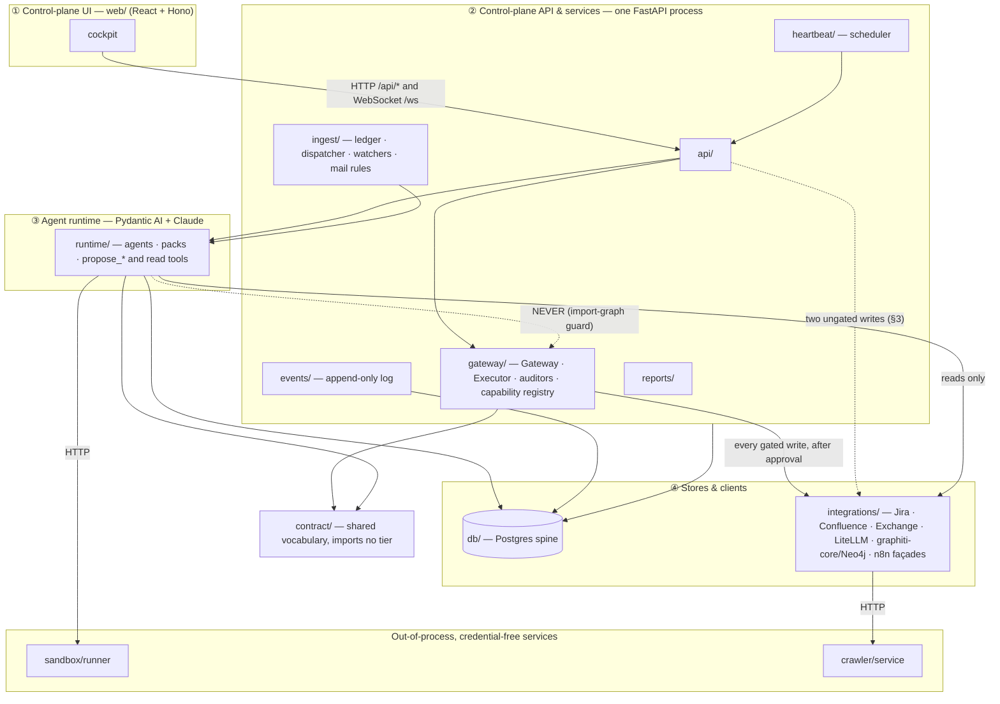

# Central Command — Architecture (the living map)

> **What this is.** How Central Command is built, **as built**: the tiers, the
> packages and what each holds, the lifecycles, the spine mechanics, the cockpit
> and the deploy surfaces. *Why* the product exists and what it must do is the
> [PRD](PRD.md) (its §3 is the glossary, its §4 the requirements); this file
> states only how, and cites the PRD for the rest. [`DESIGN.md`](DESIGN.md) is
> the *founding* design, frozen; where it and this file disagree, the code and
> this file win.
>
> **What this is not.** A rulebook. The rules, the decision log, the design
> records and the unfinished work are each routed in §8; this file links to
> them rather than restating them.
>
> **Keeping it true.** Every row below names a path. When you move or rename a
> seam, **fix the row in the same change.** That is enforced, not hoped for:
> `tests/test_architecture_doc.py` fails when a package or module is missing
> from the package map, when a named path does not exist, or when a recomputable
> count (capabilities, heartbeat action kinds, event types, state sets, cockpit
> routes, k3s manifests) no longer matches the tree. There is no version stamp
> on purpose — the guard is the verification. Anything that could not be
> verified is marked *(unverified)*, never guessed. A row about something
> deleted says "deleted in vX.Y.Z" in the same line; history is a record, not a
> claim about the tree.

## 1. The paradigm in one screen

A **modular monolith in four tiers** built around one idea: **agents propose,
a gate approves, a credentialed Executor performs** (PRD §1, §4.1). The trust
boundary is not a network hop or a permission table — it is the **Python import
graph**: `central_command/runtime/` may never import `central_command/gateway/`
(guard: `tests/test_governance.py::test_runtime_never_imports_the_gateway_tier`,
an AST walk over every runtime module).

### What each tier holds

"Holds" means code in the tier reads a credential of that kind from `config.py`
(`settings`) or the environment. The sentence the table exists to keep true:
**the runtime holds read credentials and no write path; no credential an agent
can reach changes anything.**

| Tier | Holds | Does not hold |
|---|---|---|
| ① cockpit (`web/`) | The API's address (`GATEWAY_URL`); no external credential | Anything for Jira, Confluence, mail, the graph or the model proxy |
| ② `gateway/` (Executor) | Every **write** credential: Jira, Confluence, the git forge, the n8n façades (mail, calendar), Exchange, the LiteLLM administration database and its salt key, the scoped kubeconfigs for model and MCP changes | — (this is the only tier that writes after a decision) |
| ② `api/` | The Postgres DSN; the **Neo4j bolt password** (operator graph curation through `integrations/neo4j_writer.py`, and the Graph panel's reads through `integrations/neo4j_reader.py`); the **LiteLLM proxy key** for speech (`api/speech.py`) | A credential an agent can reach: agents never call the API tier's code |
| ② `ingest/`, `heartbeat/`, `events/`, `reports/` | The Postgres DSN; `ingest/` reads mail and files through the façades; `ingest/wiki_freshness.py` holds the Confluence write used by the config-gated stale-page annotation (default off) | Any agent-directed write |
| ③ `runtime/` | **Read credentials only**: Jira, Confluence, forge, graph reads over bolt (`integrations/graphiti.py`, `neo4j_reader.py`), mail façade reads, Exchange reads, the LiteLLM proxy key for model calls and `/model/info`, the credential-store listing; the sandbox client (a mutating client against a credential-free sandbox) | A write path: no module under `runtime/` may reach a write method of a credentialed client, nor the graph write modules. Guards: `tests/test_runtime_integration_reads.py` (frozen per-client allowlist, DL-103) and `tests/test_governance.py` |
| ④ `db/`, `integrations/` | `db/`: the DSN. `integrations/`: the client for each external system, each holding its own credential | — |
| `sandbox/`, `crawler/` | **Nothing, by design** | Credentials of any kind |

**What the runtime can reach.** `runtime/` imports `integrations/` clients, and
every call it makes against a credentialed system is a *read* (Jira,
Confluence, the git forge, Graphiti, LiteLLM `/model/info`, the mail façade's
`list_refs`/`get_message`, Exchange `configured`, the credential store's
provider listing, web fetch). The one mutating client it uses is
`integrations/sandbox_client.py`, against the sandbox — which holds no
credentials by design (containment, not restriction; see AGENTS.md). Every
**gated** write method on a credentialed client is called from
`gateway/executor.py`; the two writes that are not gated are listed under
"Who may approve what" in section 3, with their callers. The read-only property
is a guard test, not an inspection: `tests/test_runtime_integration_reads.py`
walks every module under `runtime/`, resolves every name bound to an
`integrations` submodule, and checks each attribute reached through it against a
frozen per-client allowlist of confirmed reads — so a write that appears in the
runtime tier fails the suite in the commit that adds it (DL-103).

**Two intentional package cycles**, both broken with function-scoped imports
and neither crossing the forbidden edge: `api ⇄ gateway` (`api/routes.py`
imports the gateway at module level; `gateway/gateway.py` reaches back into
`api.orchestration` lazily) and `api ⇄ runtime` (`runtime/questions.py`
and `runtime/converse.py` lazily import resume callbacks from
`api/orchestration.py`, and `runtime/tools.py`'s `create_task` lazily calls
`api.routes.create_and_run_task`). `heartbeat/` reaches `api/` the same lazy way but may
never import the gate. `contract/` imports nothing from `api`, `gateway` or
`runtime`; `sandbox/` and `crawler/` import nothing from `central_command` at all.

## 2. Package map

Every package and module under `central_command/`; a module that is not in its
package's rows fails the guard. "Creds" is defined in the tier table above.
Rows for the same package are grouped by what the modules are for.

| Package | Tier | Creds | What it is | Modules and key seams | Rules |
|---|---|---|---|---|---|
| `api/` | ② | DSN, bolt, speech key | The FastAPI app: JSON API, SSE stream, the cockpit's WebSocket gateway, the orchestration driver, updates, systems launchpad, attachments, speech, the readiness self-check | `app.py` (assembly), `routes.py`, `nerve_gateway.py` (`/ws`), `orchestration.py`, `backstops.py`, `hold.py`, `update.py`, `systems.py`, `attachments.py`, `speech.py`, `selfcheck.py` (`GET /api/selfcheck`, `POST /api/selfcheck/run`) | [cockpit](../.claude/rules/cockpit.md), [runtime-resilience](../.claude/rules/runtime-resilience.md) |
| `gateway/` | ② | **write** (via Executor) | The trust boundary: the one approval seam, the Executor, the capability registry (96 capabilities, each declaring its `default_gate` — `human`, `auditor` (only `work.bulk_dismiss`, the class a graduated auditor may confirm; no behaviour change) or `none` — as a column in code, never a table), the dismissal auditor, the graph auditor, deterministic policy checks, agreement records, wiki-claims capture | `gateway.py` (`approve_and_execute`, `reject_with_feedback`, `dismiss_proposal`, `retry_execution`), `executor.py` (`execute`), `capabilities.py` (`REGISTRY`), `auditor.py` (`audit_dismissal`), `graph_auditor.py`, `overrides.py` (`author`, `revoke`, `resolve`, `decide_on_park`, `decide_landed`, `override_sweep`, `PARK_SITES`, `scope_covers`, `validate_scope`, `scope_text`), `policy.py`, `steward_agreement.py`, `wiki_claims.py` | [AGENTS.md](../AGENTS.md) |
| `runtime/` | ③ | **read only** | The seams every run passes through: model resolution, tool surface, durable pause/resume, proposals, questions | `models.py` (`resolve_model`), `packs.py` (`toolset_for`), `tools.py` (the `propose_*` and read tools, and `create_task` — the one direct trigger tool, holding no credential: it reaches `routes.create_and_run_task` by a function-scoped import), `durable.py` (`proposal_from_call`), `proposals.py` (`park_proposal`), `run.py` (`run_task`, `run_coach`), `agent.py` (`build_agent_for`, resume only), `deps.py`, `questions.py`, `resume_park.py`, `skills.py`, `spike_model.py` (the deterministic demo and test doubles `resolve_model` swaps in under `CC_DEMO_MODE`; first built for the M2 spike) | [runtime-resilience](../.claude/rules/runtime-resilience.md), [models](../.claude/rules/models.md) |
| `runtime/` | ③ | **read only** | Conversations and teamwork: operator conversations, consults, discussions, reflection, the attention budget, accountability check-ins, first-run tour | `converse.py`, `consult.py`, `discussions.py`, `reflection.py`, `attention.py`, `accountability.py`, `tour.py`, `context.py` (context-window pressure) | [runtime-resilience](../.claude/rules/runtime-resilience.md) |
| `runtime/` | ③ | **read only** | The roster as data: how an agent joins the team, hire templates, the update hold flag | `roster.py`, `hiring.py`, `templates.py`, `hold.py` | [AGENTS.md](../AGENTS.md) |
| `runtime/` | ③ | **read only** | The agents, one module per entry point and one per built-in charter ("v0"). Several agents have no run path of their own: they are tasked (`run_task`), conversed with or consulted. Agents: EA, knowledge steward, editor, Jira expert, Confluence expert, LiteLLM manager, MCP manager, wiki agent, coach, orchestrator (a router; holds no `propose_*` tools), and the two auditors and the graph curator (charters only) | `ea.py`, `ea_profile.py`, `steward.py`, `steward_profile.py`, `editor.py`, `editor_profile.py`, `jira_expert.py`, `confluence_expert.py`, `litellm_manager.py`, `litellm_manager_profile.py`, `mcp_manager.py`, `mcp_manager_profile.py`, `wiki_agent.py`, `coach_profile.py`, `orchestrator.py`, `orchestrator_profile.py`, `auditor_profile.py`, `graph_auditor_profile.py`, `graph_curator_profile.py` | [models](../.claude/rules/models.md) |
| `contract/` | shared | none | The vocabulary both tiers speak: proposal models, status enums, `ARG_SPECS` argument shapes, `claim_supported`, the failure taxonomy (DOWN vs NO), the dependencies each live read waits on (`TOOL_DEPENDENCY`), one-click-unsubscribe eligibility | `args.py` (`ARG_SPECS`, `validate_action_args`), `models.py` (`claim_supported`), `enums.py`, `failures.py` (`is_transient`), `dependencies.py` (`DEPENDENCIES`, `TOOL_DEPENDENCY`, `CAPABILITY_DEPENDENCY`), `mail.py` | [AGENTS.md](../AGENTS.md), [integrations](../.claude/rules/integrations.md) |
| `db/` | ④ | DSN | The Postgres spine: one asyncpg access layer and the schema | `repo.py` (the access layer — nearly all SQL), `schema.sql` (auto-loaded on a **fresh** database only). SQL outside it: three advisory-lock leases (`heartbeat/engine.py`, `ingest/dispatcher.py`, `integrations/graphiti_ingest.py`), the readiness queries in `selfcheck.py`, and `integrations/litellm_credstore.py`, which reads LiteLLM's own database | [AGENTS.md](../AGENTS.md) |
| `events/` | ② | none | The append-only event log: write to Postgres, then fan out; WARNING+ log records bridged into events | `log.py` (`events.emit`, the only publish path), `bridge.py` | [AGENTS.md](../AGENTS.md) |
| `ingest/` | ② | read (mail, files); Confluence write for the gated-by-config annotation | Feeds and the dispatcher: the Work Ledger, the live mail feed, backlog enrollment, the backpressure dispatcher, standing mail rules applied before any model call | `ledger.py` (`enroll_*`, `hydrate_work_item`), `feed.py` (`poll_once`), `dispatcher.py` (`process_claimed`, the one path every item takes), `mail_rules.py` (rules applied before the model; `mail.create_rule` is gated), `mailtext.py` (the one mail-body converter) | [integrations](../.claude/rules/integrations.md), [`QUEUE.md`](QUEUE.md) |
| `ingest/` | ② | as above | The sources catalog and bulk actions: filesystem watcher, text extraction (the markitdown seam shared with chat attachments), catalog enrollment, bulk dismissal, the wiki freshness sweep | `watcher.py`, `extract.py`, `catalog_enroll.py`, `bulk_dismiss.py`, `wiki_freshness.py` | [integrations](../.claude/rules/integrations.md) |
| `heartbeat/` | ② | none | The scheduler for recurring team work: tick loop, action registry, dependency-health probes | `engine.py` (`fire`, one firing path for tick and run-now), `actions.py` (`ActionSpec`, 12 action kinds), `probes.py` | [runtime-resilience](../.claude/rules/runtime-resilience.md) |
| `integrations/` | ④ | each client holds its own | **Native clients**: Jira, Confluence, the git forge, LiteLLM (proxy) and its credential store, the Exchange (EWS) mail client, Neo4j (reads and the closed curation write set) | `jira.py`, `confluence.py`, `forge.py`, `litellm.py`, `litellm_credstore.py`, `exchange.py`, `neo4j_reader.py`, `neo4j_writer.py` | [integrations](../.claude/rules/integrations.md) |
| `integrations/` | ④ | as above | **graphiti-core, in-process** (no server): `graphiti.py` reads (the one graph module `runtime/` may import; it imports graphiti-core search modules function-locally, after the client has prepared the environment), `graphiti_client.py` is the one place the library is built and configured, `graphiti_ingest.py` is the durable ingest queue's worker, `graph_ontology.py` holds the ten entity types, `graphiti_patches.py` applies the two carried graphiti-core fixes | `graphiti.py`, `graphiti_client.py`, `graphiti_ingest.py`, `graph_ontology.py`, `graphiti_patches.py` | [graph](../.claude/rules/graph.md), [models](../.claude/rules/models.md) |
| `integrations/` | ④ | n8n holds the OAuth | **n8n façades** for mail and calendar (n8n holds the OAuth; the Jira façade fallback was removed in v2.50.0). **Uncredentialed**: web fetch, the crawler client, the sandbox client. `http.py` is the pluggable-trust httpx factory (CA bundle / mTLS) | `email_facade.py`, `calendar_facade.py`, `webfetch.py`, `crawler.py`, `sandbox_client.py`, `http.py` | [integrations](../.claude/rules/integrations.md) |
| `reports/` | ② | none | Deterministic, judgment-free reads composed from the spine: the EA's snapshot, the operator's calendar day, the EA's open follow-ups; called only from `runtime/tools.py` and `heartbeat/actions.py` | `ea_report.py`, `ea_calendar.py`, `ea_followups.py` | — |
| `sandbox/` | out-of-process | **none, by design** | A standalone FastAPI service giving agents a disposable workspace. Two backends behind one API: `kubectl` (a gVisor Job+Pod per session) or `podman` (a container per session). Never imported; reached only through `integrations/sandbox_client.py`. Its single exit is the gated `mcp.sync_source`, content captured at propose time | `runner.py` | [AGENTS.md](../AGENTS.md) |
| `crawler/` | out-of-process | none | A standalone browser-rendering crawl service for whole-site documentation import. Never imported; reached through `integrations/crawler.py`, whose only caller is `skills/site_import.py` | `service.py` | — |
| `skills/` | ②/③ | none | The skills library's import side: `SKILL.md` + references → DB rows and a chunked search index (`chunking.py`); whole-site import | `importer.py`, `site_import.py`, `ids.py`, `chunking.py` | — |

Top-level modules of `central_command/`: `config.py` holds every `CC_*` setting
(`settings`), with its comment as documentation; `selfcheck.py` is the
application self-check — the install proved as the app, one implementation run
from the command line (`python -m central_command.selfcheck`) and from
`api/selfcheck.py`; it reads the spine directly and reports readiness only.

### The parts `DESIGN.md` does not describe

- **`api/backstops.py` is the task-create seam's provenance and loop breaker.**
  `routes.create_and_run_task` is the one task-create path; the `task` row
  records `created_by` (`operator` | `heartbeat:<schedule>` | `agent:<id>`;
  NULL on older rows, read as operator), `approved_by` (the approver, on a task
  created while `task.create` was gated; NULL since it left the gate),
  `parent_task_id`
  and `creator_chain` (agent ids, root first, including the immediate creator).
  All are derived server-side from `parent_session_id` — the creator from the
  session row, the parent task from `repo.task_for_session` — never from tool
  arguments; a creating session with no task of its own (chat, a consult
  specialist) inherits the chain, and takes as its parent task the task, of its
  nearest task-bearing ancestor session (`parent_session_id` — a mid-chain
  consult session is minted with its asker as parent — or the asking session
  on a consult proposal's `origin`). A creation is refused, with reason `self` (the assignee is the
  creator), `cycle` (the assignee is already in the chain, the orchestrator
  included), `depth` (the chain would exceed `task_max_depth`, default 3:
  agent-created tasks in the lineage including the new one) or `no-assignee`
  (an agent-created task must name one) or `fan-out` (the creating task has
  already made `task_fanout_limit` tasks, default 25, counted by
  `parent_task_id` so a retry-parked re-run in a new session continues the
  count; a creator with no task is counted by its session; the orchestration
  driver's `assign_work` lands on the same seam, counted against its project
  task, beside its own `orch_fanout_limit` park): it writes no row, emits
  `task.refused` (`ref_id` the parent task, else the creating session; payload
  `reason`, `chain`, `creator`, `agent_id`; plus `limit`, `created` on a
  fan-out) and returns a 422 naming the
  reason; `self` and `cycle` refusals also name the taskable teammates (the
  roster's `taskable_agent_ids()`, minus the chain) the creator may use
  instead. Operator and heartbeat creations are roots and never trip these.
  The three founding guards that kept the orchestrator out of agent-created work are gone: an agent-created task may be
  assigned to the orchestrator and runs as a project (its plan parks for the
  operator before round one); its children carry the project task as parent
  and the chain plus the orchestrator, so depth, cycle and fan-out hold. The
  driver pre-checks a whole `assign_work` batch against these (the i-th
  assignment judged with the i before it counted toward fan-out) before any
  child is created; a refusal is a problem line in the batch's tool result
  and one `task.refused`, and the orchestrator assigning to itself is
  refused early as a cycle. **The fan-out count and the task insert are one
  critical section:** for an agent creator `create_and_run_task` holds a
  transaction-scoped Postgres advisory lock (`repo.fanout_lock`, on a dedicated
  connection, keyed `hashtextextended('task-fanout:' || ref, 0)` where `ref` is
  the creating task, else the creating session — the key `count_child_tasks`
  counts by) from the backstop check to the insert, so N+1 simultaneous
  creations from one creator leave exactly N rows and one `task.refused`; the
  `create_task` tool is also `sequential`, so one run cannot race itself.
  **A creator may wait on the task it created** (`create_task(await_result=
  true)`): the tool creates and launches the task, then ends the run with a
  deferral carrying the task id; the driver parks the session `AWAITING_AGENTS`
  with `run_state.task_wait` through `consult.park_task_wait_deferred` (no
  gateway in the path). The task going terminal wakes it (`child_resolved`
  → `resume_task_wait`, the task's distilled outcome as the tool result), and
  so does the restart sweep; a task already terminal when the park commits is
  woken by the park itself. A refused creation (cycle, depth, fan-out) never
  parks, and a consulted specialist neither holds the tool nor parks.
- **`api/orchestration.py` is a driver; `runtime/orchestrator.py` is an agent.**
  The agent holds no `propose_*` tools — it recommends routing and changes
  nothing. The driver (tier ②) runs multi-agent *projects* as a durable plan →
  assign → receive → decide loop: it parks on deferred tool batches, creates
  child tasks, and resumes after decisions (`run_project`, `maybe_resume`,
  `resume_sweep`, `resume_parked_session`, `resume_consult_wait`,
  `resume_task_wait`, `retry_parked_task`, `continue_session`). It is also where
  the retry sweep lives (`retry_sweep`), because that sweep must reach
  `gateway.retry_execution`.
- **`api/nerve_gateway.py`** answers the cockpit's gateway wire protocol
  (request/response/event frames over WebSocket at `/ws`). It is a
  read-and-plumbing surface; writes go through the same gateway functions the
  HTTP routes call.
- **`api/hold.py`** is the update hold: pause the team, wait for in-flight
  agent work to land, then trigger the updater. The flag the runtime reads is
  `runtime/hold.py`, in memory on purpose.
- **`api/update.py`** serves the single-node profile's version check and
  upload/apply/status routes; the k3s profile's updater is driven from the
  cockpit server (`web/server/routes/cc-update.ts`) through systemd path units.
- **`gateway/capabilities.py`** is "executable truth": each `Capability` row
  carries `kind`, `gate`, `risk` (free text — what a wrong use costs),
  `holder`, `route` and `arguments`, plus `default_gate` that gate overrides
  resolve against, and, on every write, the server-held `reversibility`
  (`reversible | irreversible`), `target_args` (the arguments naming the write's
  world target, empty when it has none) and `acknowledge` (an override on it needs the
  operator's recorded acknowledgement and a shadow period of at least 1). The
  mark informs and forbids nothing; it is never read from the proposing
  agent's own `Action.reversibility`. Agent charters' capability sections are
  *generated* from pack grants over this registry at run start.
- **The Executor replays by cursor.** The completed-actions list is the
  cursor, so a half-landed non-idempotent write may be applied twice on retry;
  façade idempotency keys are the owed fix (PRD §6.2).

## 3. Lifecycles, as built

### Wake sources

An agent run starts from exactly **three** sources: the **heartbeat** scheduler
(`heartbeat/engine.py` firing a governed schedule row), the **ledger
dispatcher** (`ingest/dispatcher.py` claiming a work item), and **direct
tasking** (the operator, a heartbeat action, the orchestration driver, or an
agent's own `create_task` call, all through `create_and_run_task`). An agent
creating a task is a trigger, not a gated write and not a gate exemption: no
proposal and no inbox item; any active agent but the auditor may create and
assign one to any agent, the orchestrator included, bounded by depth 3, self/
cycle and fan-out 25, with a refusal returned as text and recorded loudly as
`task.refused`; the run it starts gates its own world changes like any other. There is no event-subscription wake and no
agent-to-agent request event: collaboration is a **consult** (the asker parks
`AWAITING_AGENTS`) or a **task**.

### Proposal

```mermaid
stateDiagram-v2
    [*] --> AWAITING_HUMAN: runtime/proposals.park_proposal — persist, then emit proposal.created
    AWAITING_HUMAN --> EXECUTING: gateway.approve_and_execute → repo.claim_proposal_for_execution
    EXECUTING --> EXECUTED: repo.set_proposal_executed (provenance stamped)
    EXECUTING --> RETRY_PENDING: dependency DOWN → repo.park_proposal_retry
    RETRY_PENDING --> EXECUTING: retry sweep or the operator's retry-now → gateway.retry_execution (an interrupted one: only the operator's flag)
    RETRY_PENDING --> WITHDRAWN: gateway.dismiss_proposal — one SQL-guarded transition; the execution is withdrawn, the task FAILED
    EXECUTING --> FAILED: the dependency said NO (or the world moved: proposal.failed carries world_moved) — drafter RESUMES; a redraft parks with proposal.redraft linking it
    AWAITING_HUMAN --> REJECTED: gateway.reject_with_feedback — drafter RESUMES and may redraft a new proposal
    AWAITING_HUMAN --> WITHDRAWN: gateway.dismiss_proposal — folds released, session closed, drafter NEVER resumed
    EXECUTED --> [*]
    FAILED --> [*]
    REJECTED --> [*]
    WITHDRAWN --> [*]
```

- **Before the gate.** A `propose_*` tool validates argument shape against
  `contract.ARG_SPECS` (a malformed draft goes back to the model as a
  `ModelRetry`, up to `max_retries=10`), then the run pauses at a deferred call
  and `park_proposal` is the one path into the queue.
- **At the gate.** `proposal.decided` is emitted inside
  `approve_and_execute` *before* `executor.execute()` runs. The Executor
  re-runs the same shape validation over every action before the first one
  runs, then world-state checks, then the handlers; `proposer` comes from the
  gateway, never from the agent's arguments.
- **After the gate: a NO, and the world moved.** A semantic failure lands the
  proposal FAILED, releases its folds, emits `proposal.failed`
  (`failed_capability`, `error`, `transient`, `completed_actions`,
  `world_moved`) and resumes the drafter with the honest partial report.
  `world_moved` is set when the handler raised the typed verdict
  `contract.failures.WorldMoved` (decided by type, never by text; today
  `confluence.ConfluenceStale`, a stale page version or a 409 whose body names
  a version conflict): `{capability, target, expected, actual, what_moved}`,
  carried on `ExecutionFailed.world_moved` and never on `transient` — it is a
  NO, never parked. Its resume report says what moved, that nothing past the
  completed actions was written, and to read the target again and redraft or
  close out in text; the resume runs under the charter the proposal was
  drafted under (`build_agent_for` over the persisted history). A redraft
  carries its link on the row, `proposal.redraft jsonb` — `{of, root, cause:
  world_moved | failed | rejected, world_moved_count}`, null on a first draft,
  written only by `park_proposal` and mirrored into `proposal.created`'s
  payload (`gateway.redraft_link` builds it from the parent row; the count
  rises only for `world_moved`; a swept resume reads the cause from
  `pending_resume.redraft_cause`). `GET /proposals/{id}` returns it as stored.
- **Gate overrides (FR-4).** An `agent_gate_override` row
  (`govr_<hex>` id; the DRAFTER as `agent_id`, a capability, a `scope` jsonb,
  `gate` `none`, `granted_by`/`granted_at`, `revoked_at`/`revoked_reason` —
  revocation is a timestamp and a row is never deleted — `shadow_runs`,
  `acknowledged_irreversible_at`) relaxes a capability's default gate for one
  agent. Resolution is override, then default (`gateway/overrides.py`
  `resolve`): the drafter's live overrides covering EVERY gated action decide
  — one override, or several different ones (the operator's ruling of
  2026-10-26: a proposal 100% covered by overrides needs no review) — and only
  for a proposal created after each was granted; one uncovered gated action
  parks the whole proposal, and an action whose default gate is `none` needs
  no cover. The decide hook
  (`overrides.decide_on_park`, called through `overrides.decide_landed`) runs
  at every API-tier landing point of a parked proposal, after the caller's own
  bookkeeping (table below), never as a `proposal.created` subscriber, and
  records the evaluation once on `proposal.override_eval`
  (`{override_id, outcome: decided | shadow | parked, reason, at}`, plus
  `shadow: [{override_id, k, n, complete}]` when an override is in its shadow
  period, `suspended: [ids]` when an override is suspended, and, when decided,
  `override_ids` and `action_map` — `{action index: override id}` for every
  gated action; `override_id` is the id when exactly one decided, else null;
  compare-and-set where null) and, when decided, calls `approve_and_execute`
  with approver `override:<id>` for one override or `override:<id1>+<id2>`
  (sorted, unique) for several: `proposal.decided` carries `override_ids`
  (and `override_id` when there is one) and still precedes the Executor.
  `overrides.override_ids_of` is the one parser of an override approver
  (`approver_for` the one writer, `decided_by_override` the event test the
  agreement readers use; the runtime coaching reader, which may not import the
  gateway, uses the same bare `override:` prefix test). **Safeguard 1, the
  pre-check and the backstop.** Before `proposal.decided`,
  `approve_and_execute` runs `overrides.check_override_approval` read-only
  against fresh rows: each named override unrevoked, its agent the drafter,
  its gate `none`, its shadow period complete (`overrides.shadow_state`, the one reading
  `resolve` also makes — safeguard 3 below), not suspended; each gated
  action's mapped override on that action's capability, `scope_covers` true,
  an acknowledgement class acknowledged; the proposal created after every override; no
  `review_flags` flag; no operator reopen note. A failure emits
  `override.refused` (`{override_id, override_ids, reason, proposal_id,
  stage: decision | execution | retry}`, actor the approver) and hands the
  claim back to AWAITING_HUMAN before raising `overrides.OverrideRefused` —
  no `proposal.decided` naming the override exists for it.
  `executor.execute` repeats the check as the BACKSTOP for an override
  approver, after its shape pass and before the first action, re-reading the
  overrides (`action_offset` maps a retry's remaining actions to their
  indices); it raises the typed `OverrideRefused` (re-exported as
  `executor.OverrideRefused`, never an `ExecutionFailed`) with nothing
  written, and the gateway emits `override.refused` and hands the claim back
  (a revoke in the window after the decision event). A retry of a
  RETRY_PENDING proposal approved by an override runs the check on the
  REMAINING actions; refused with a completed prefix, it never returns to
  AWAITING_HUMAN (that would re-run finished actions) and is recorded through
  the failure path as FAILED with the partial results on `proposal.failed`.
  **The trust stamp (safeguard 2).** Provenance is the Executor's record, never
  a caller's. The stamp vocabulary: `trust=human-approved` (an operator's
  approval; `approver=<operator>`), `trust=operator-direct` (the operator's own
  graph curation, `neo4j_writer`), and `trust=override:<id>` (a write an
  override decided; `executor.episode_source_description`, the one composition
  `graph_auditor.enqueue_cutover` also uses, so the cutover's description is
  byte-identical to the Executor's). `Provenance.approver` and the
  `proposal.executed` actor stay the proposal-level approver. Under SEVERAL
  overrides the Executor reads the stored `override_eval.action_map` itself and
  hands each handler the `override:<id>` of the override covering THAT action,
  so each write (episode source, Jira/other record) names its own override, and
  `Provenance.action_approvers` (`{"<action index>": "override:<id>"}`,
  present only under a combined approver, also on `proposal.executed`'s
  provenance) records it; an action with no mapped override (default gate
  `none`) keeps the combined approver.
  An operator's approval is never checked. **The reopen note.** A proposal
  whose session's work item carries the operator's `operator_note` (the hold
  the auditor honours) is never decided by an override: `resolve` parks it
  with `overrides.OPERATOR_HOLD_REASON`. A decision that could not run is amended to
  `parked` and logged as `override.error`. An override decision is never
  operator agreement: `steward_agreement.pair_confidence` and the coaching
  reader skip it. `resolve` honours a live override on a capability whose row
  sets `acknowledge` (every `irreversible` row, `mcp.tool_call`, and the six
  LIVE / highest-blast-radius `litellm` rows) only when it carries
  `acknowledged_irreversible_at`, and then it waits its shadow period like
  any other, floored at 1 (`capabilities.requires_acknowledgement`,
  `effective_shadow_runs`), and
  never for the auditor, the one hard exclusion. No override is seeded; any
  capability whose default gate is `human` or `auditor` may be overridden.
  **Authoring is the operator's alone** (`overrides.author` / `overrides.revoke`,
  reached only from the REST routes `GET|PUT|DELETE /agents/{id}/gate-overrides`
  and `GET /capabilities/{name}/gate-overrides`, and the cockpit RPC
  `overrides.list` / `overrides.author` / `overrides.revoke`; a source walk pins
  those callers, and no agent tool, pack, capability, heartbeat action, chat
  lane or charter text names an override). `author` refuses an unknown agent
  or capability (404), the auditor as the override's agent, a default gate of
  `none`, a scope `validate_scope` rejects, an acknowledgement class without
  `acknowledge_irreversible` (422) and a second live override on the same
  agent, capability and scope (409); it writes through
  `repo.create_gate_override(shadow_runs=None)` (the setting, floored) and
  stamps `acknowledged_irreversible_at` when the class requires it. An agent
  with no pack covering the capability still gets the override, born
  suspended, and the response's `warnings` says so. `revoke` timestamps the
  row (409 when already revoked); a scope change is a revoke plus a new id
  with a fresh shadow period. `override.created` / `override.revoked` follow
  their writes (bookkeeping). The listing row (`overrides.describe`, pinned by
  `tests/test_overrides_wire.py`) carries `id, agent_id, capability, scope,
  scope_text, state (shadow | live | suspended | revoked), shadow {k, n},
  matches, last_match, granted_by, granted_at, revoked_at, reversibility,
  requires_acknowledgement`; `matches` counts the agent's proposals the
  override's capability and scope covered while it was unrevoked
  (`repo.override_match_candidates`, any status, redrafts and follow-ons
  excluded). `GET /capabilities` (and RPC `capabilities.list`) adds per row
  `requires_acknowledgement`, `scope_forms` (`argument` only with an
  `ARG_SPECS` entry, `target` only with `target_args`, `schedule` always),
  `overridable` and `overridable_reason` (`capabilities.registry_as_dict`).
  **Safeguard 3, the shadow period.** A NEW override is shadowed: a proposal
  it covers parks for the operator until the operator has approved N matching
  proposals. N is the setting `gate_override_shadow_runs`
  (`CC_GATE_OVERRIDE_SHADOW_RUNS`, default 5; 0 turns the period off, except
  that a class requiring acknowledgement is floored at 1,
  `capabilities.effective_shadow_runs`), COPIED onto the row's `shadow_runs`
  when it is authored (`repo.create_gate_override`), so changing the setting
  never alters an override already authored. Progress is computed fresh from
  the proposal rows, no counter column (`overrides.shadow_progress`,
  `repo.shadow_approval_candidates`) over a window pinned to the override: a
  proposal drafted by its agent, **created after its `granted_at`**, matching
  its capability and scope (`scope_covers`, the matcher the decision uses),
  **EXECUTED with a human approver** (`provenance.approver` `human:*` — an
  override's, the auditor's or `system`'s approval never counts), and not a
  redraft or a follow-on (recorded unevaluated). Rejected, dismissed and
  withdrawn proposals never reach EXECUTED; a proposal created before the
  grant and approved after does not count; a proposal evaluated while the
  override was suspended (`override_eval.suspended`) counts nothing for it.
  While k < N the hook parks the proposal with `override_eval` outcome
  `shadow` and `shadow` marks, written before anything but the log hears of
  it, then emits `override.shadowed` per shadowing override (`{override_id, k,
  n, proposal_id, overrides}`, ref the proposal). When an override that has
  completed its period is about to make its first decision the hook emits
  `override.live` once (`{override_id, shadow_runs, progress, proposal_id}`,
  ref the override, deduplicated on the log), before that decision's
  `proposal.decided`. **Several overrides:** a proposal is decided only when
  EVERY override covering one of its gated actions is past its period;
  otherwise it parks marked with each override's k of N, and the operator's
  approval of it counts toward every override it matched. The pre-check and
  the Executor's backstop refuse an override still in its period (`k of N` in
  the reason).
  **Which gate decided (story 10).** The proposal detail (`GET /proposals/{id}`,
  `proposals.get`), the pending list (`decisions.list`) and the history
  (`decisions.history`) carry two derived fields (`routes.annotate_gate_facts`,
  pinned by `tests/test_overrides_wire.py`): `decided_by`, null while undecided,
  else `{kind: operator | auditor | override, overrides: [{override_id,
  scope_text}]}`, read from the newest `proposal.decided` actor (provenance
  approver as fallback) and parsed only by `overrides.override_ids_of`, so a
  multi-override decision lists every override and an override is never shown
  as the operator; and `shadow`, `[{override_id, k, n, complete}]` on a pending
  proposal in a shadow period (else `[]`), with k recomputed fresh by
  `overrides.shadow_state` because the stored mark is as of the evaluation. The
  cockpit renders `scope_text` and builds none.
  **Scope.** A row's `scope` is `{}` (every use) or any of three forms, ANDed,
  with no regex and no time windows: `argument` (`{name, values}`: exact
  values of one named argument, which must exist in `contract.ARG_SPECS` for
  the capability; the seven gated writes with no `ARG_SPECS` entry take none),
  `target` (a list of values matched against the registry's
  `Capability.target_args`, ALL of which must match; Jira by project prefix of
  the issue key; a row declaring none takes no target scope) and `schedule` (a
  heartbeat schedule id, matched against the drafting task's
  `created_by = heartbeat:<id>` via `repo.task_for_session`; a ledger-sourced
  proposal has no task and never matches). `overrides.scope_covers` is the pure
  match, read from the arguments the Executor will use, `proposal.agent_id` and
  the task row, never the agent-written `target_ref`; a proposal is decided
  only if every gated action is covered, else the whole proposal parks.
  `validate_scope` is the authoring check and `scope_text` the one plain-words
  rendering every screen shows.
  **What a reviewer would have seen flagged is never decided by an override.**
  `resolve` parks a covered proposal (reason recorded) on any
  `policy.check_actions` flag, any `policy.check_grants` flag, any
  `policy.check_charter_content` flag on a `charter.update`'s content (the same
  calls the Inbox review makes in `api/routes.py`), any
  `contract.validate_action_args` problem, and any evidence item whose recorded
  `claim_matches_source` is `false` (`null`, not checked, does not park):
  `overrides.review_flags`. An override is carried on the agent's live pack
  grant: one whose capability no live grant covers
  (`packs.granted_capability_names(granted_packs(agent))`) is **suspended**,
  computed fresh on every evaluation and lifted by a re-grant; `resolve`
  reports it (`Decision.suspended`, `override_eval.suspended`). Two parks are
  never evaluated and are recorded at the park itself
  (`overrides.record_unevaluated_park`, `override_eval` reason `redraft` or
  `follow_on`, outcome `parked`): a **redraft** (`gateway._park_redraft`,
  after a Reject or a failed execution, and a redraft of a redraft) never
  auto-executes under an override; a **follow-on** parked on the approved leg
  (context `follow_on_of`) goes to the operator by default.
  **Where the hook runs.** Every `park_proposal` call site, mapped to the
  caller that runs the hook (`overrides.PARK_SITES`; a source walk in
  `tests/test_gate_overrides.py` fails the suite on an unmapped site — the walk
  cannot see the API caller of a `runtime/` site, hence the table):

  | Park site | Hook runs in |
  |---|---|
  | `runtime/run.py` `ingest_and_propose` | `ingest/dispatcher.py::process_claimed`, at function scope after the fold reservation and the auditor's bulk hook, before `work.processed` |
  | `runtime/steward.py` `run_document` | the dispatcher, same place |
  | `runtime/wiki_agent.py` `run_repair` | the dispatcher, same place |
  | `runtime/run.py` `_land` | `api/routes.py::_run_one_assigned_task` (after `task.review`); `orchestration._land_task_question_outcome` for `continue_session` / `resume_stopped_session` |
  | `runtime/run.py` `run_coach` | `routes.coach_agent` (synchronous) and `routes._run_coach_detached` (after `task.review`) |
  | `runtime/converse.py` `_land_turn` | the chat lane `api/nerve_gateway.py::_chat_send` (after the turn's end frame); the heartbeat nudge `heartbeat/actions.py::_nudge_discussion` (detached, via `orchestration.decide_landed_detached`); the converse branches of `continue_session` / `resume_stopped_session` |
  | `runtime/questions.py` `_settle` | `orchestration._land_task_question_outcome` (every answered-question resume) |
  | `runtime/consult.py` `consult` | the asker's own landing: the consult-wait result carries the specialist's `proposal_id`, decided once the asker is parked |
  | `api/orchestration.py` `_settle_consult_resume` | `orchestration.resume_consult_wait` and `resume_parked_session` (`after=consulted`) |
  | `runtime/reflection.py` `_propose_episode` | none inline (a background task off `close_session` with no API-tier landing): the startup sweep |
  | `gateway/gateway.py` `_park_redraft` | exempt: recorded unevaluated (`redraft`) |
  | `gateway/gateway.py` `finish_decision_resume` | exempt: recorded unevaluated (`follow_on`) |

  For `work.bulk_dismiss` the override hook runs after the auditor's: a CONCUR
  that already executed leaves nothing AWAITING_HUMAN to decide, and a
  CHALLENGE or audit error that fell to the operator may be decided by a
  covering override. An error inside the hook never fails its caller: the
  proposal stays AWAITING_HUMAN and `override.error` is written
  (`stage: "evaluate"` when the evaluation itself raised). **Startup sweep.**
  `overrides.override_sweep` runs at startup in `api/app.py`, after
  `auditor.audit_sweep` in the same background task, over
  `repo.override_sweep_candidates`: AWAITING_HUMAN proposals with a null
  `override_eval`, created after the `granted_at` of a live override of their
  drafter, in a session that is not RUNNING — so an item the operator could
  already see before the override existed is never decided, and a caller still
  doing its bookkeeping is never raced.
- **Operator routes.** `POST /proposals/{id}/approve | reject | dismiss`
  (`api/routes.py`); the cockpit reaches the same gateway functions over `/ws`.
- **Folds.** Sibling work items folded into a proposal sit in `FOLD_PENDING`;
  they go terminal (`FOLDED`) only when the covering proposal executes
  (`repo.commit_folds`) and return to `UNPROCESSED` on reject, dismiss or failure.
- **Founding states that were never built.** `DESIGN.md` §2 lists DRAFT,
  UNDER_AUDIT, AUTO_APPROVED, STALE and EXPIRED; none exists in code.
  `ProposalStatus.proposed` is only the in-memory default of a proposal
  record before it is parked — it is never persisted (rows begin at
  `AWAITING_HUMAN`); `ProposalStatus.approved` is declared and tolerated in a
  few `status in (...)` reads but never assigned.

### Who may approve what

Every gated world-change passes **one seam** (`gateway.approve_and_execute`).
What varies is the approver.

| Category | Approver | Classes today | Switch (default) |
|---|---|---|---|
| **Human gate** — the baseline for everything | the operator | every capability whose `gate` is human approval: Jira, Confluence, calendar, mail, graph episodes and curation proposals, charter edits, MCP sync, model configuration, … | — |
| **Graduated class** — the independent auditor re-derives the judgment from the raw source; a **CONCUR** executes with `approver="auditor"`, a **CHALLENGE** or an auditor error parks for the operator | the auditor, per class, revocable | `dismissal.confirm` (email dismissals) and `work.bulk_dismiss`; `dismissal.confirm.document`; graph-verification rows that are aligned, mechanically clean and addition-only (invalidations always park) | `CC_AUDITOR_ENABLED` (false) + `CC_AUDITOR_MODE` (shadow); `CC_AUDITOR_DOCUMENT_MODE` (shadow); `CC_GRAPH_AUDITOR_ENABLED` (false) + `CC_GRAPH_AUDITOR_MODE` (shadow) |
| **Gate override** — the operator's standing rule for one agent and one capability, scoped and narrowable by argument, target or schedule; the proposal is still decided at the seam, by the gateway, and run by the same Executor | `override:<id>` (`override:<a>+<b>`, sorted, when several cover it) | any capability whose default gate is `human` or `auditor`, for any agent but the auditor; none exists until the operator authors one in the cockpit. Three safeguards: (1) the gateway pre-checks and the Executor re-checks the scope before the first action; (2) the write carries `trust=override:<id>`; (3) a shadow period of the operator's own approvals first, and one-click revoke on the agent's and the capability's pages. An irreversible or LIVE class also needs an acknowledgement at authoring and a shadow of at least 1. Never operator agreement for graduation | `CC_GATE_OVERRIDE_SHADOW_RUNS` (5) |
| **Ungated deterministic write** — exactly two, no proposal, because there is no agent judgment to review | code, or the operator's own click | the closed `EXEMPT_WRITES` tuple beside `REGISTRY` names them (they are not registry rows); task creation is a trigger, has no row and is not on the list. (1) operator graph curation: a closed write set in `integrations/neo4j_writer.py`, called from `api/routes.py` for the operator's own edits; (2) wiki stale-page annotation: a deterministic template over claim rows, no model in the path, whose Confluence write is made by `ingest/wiki_freshness.py` | — ; `CC_WIKI_ANNOTATION_MODE` (off) |

**The default gate** is a registry column, `Capability.default_gate`
(`gateway/capabilities.py`), never a table (DL-143): `human` on 63 rows (every
gated write but one), `auditor` on one (`work.bulk_dismiss`, the class a
graduated auditor may confirm; the `CC_AUDITOR_*` switches still decide) and
`none` on 32 (the 28 reads and the 4 sandbox writes). An override relaxes
`human` or `auditor` to `none`, never the reverse; relaxing to `auditor` is
graduation's job. **The exemption list** is the two ungated deterministic writes
above, named once in `EXEMPT_WRITES` beside the registry, closed, and growing
only by the operator's call. An override is not a third entry on it: its write
is a proposal (the exemptions create none), and task creation is a trigger with
no row and no override. The MCP tool gate (`agent_mcp_gate_override`) is a
separate, older form that governs a DIRECT tool call; it is unchanged, and
`mcp.tool_call`, the proposal capability, is overridable like any other under
its acknowledgement tick and shadow floor.

Graduation is **configuration, never code**, one class at a time,
on recorded agreement evidence (`gateway/auditor.py`,
`gateway/steward_agreement.py`, `gateway/graph_auditor.py`); a fresh install is
fully human-gated. Doctrine:
[trust-tier graduation](superpowers/specs/2026-07-30-trust-tier-graduation-design.md);
decisions: [`decisions/trust-gate.md`](decisions/trust-gate.md).

### Session

`session.status` is free text in `schema.sql` on purpose (a new wait state needs
awareness in its readers, never a migration). The values in use:

```mermaid
stateDiagram-v2
    [*] --> RUNNING
    RUNNING --> AWAITING_HUMAN: a propose_* call deferred
    AWAITING_HUMAN --> RUNNING: verdict recorded → resume
    RUNNING --> AWAITING_OPERATOR: conversation between turns
    AWAITING_OPERATOR --> RUNNING: operator message
    AWAITING_OPERATOR --> DONE: conversation ended (status flip; transcript kept)
    RUNNING --> AWAITING_AGENTS: waiting on child tasks or a consult
    AWAITING_AGENTS --> RUNNING: children landed
    RUNNING --> AWAITING_RESUME: a read, a turn or a resume leg met a DOWN dependency (resume_park)
    AWAITING_RESUME --> RUNNING: retry sweep, health-gated and on the backoff curve
    AWAITING_RESUME --> STOPPED: the operator closes a parked chat lane
    RUNNING --> AWAITING_CONTINUE: request window spent — never auto-driven
    RUNNING --> STOPPED: operator stop — never auto-driven
    AWAITING_CONTINUE --> RUNNING: operator continues
    STOPPED --> RUNNING: operator resumes
    RUNNING --> DONE
    RUNNING --> FAILED: always with a recorded reason
    DONE --> [*]
    FAILED --> [*]
```

`contract/enums.py::SessionStatus` is a narrower, older list (it still names
`AWAITING_INPUT` and `ABORTED`, which nothing sets); the schema comment is the
authority. Sessions are never deleted, and one agent may hold several at once.

### State sets

One table, checked against the schema comments and `contract/enums.py` by the
guard (`ProposalStatus.proposed` and `.approved` are the two enum values never
persisted, above).

| Entity | States |
|---|---|
| Session | RUNNING, AWAITING_HUMAN, AWAITING_OPERATOR, AWAITING_AGENTS, AWAITING_RESUME, AWAITING_CONTINUE, STOPPED, DONE, FAILED |
| Proposal | AWAITING_HUMAN, REJECTED, EXECUTING, EXECUTED, FAILED, RETRY_PENDING, WITHDRAWN |
| Task | NEW, ASSIGNED, IN_PROGRESS, REVIEW, DONE, FAILED, CANCELLED |
| Work item | UNPROCESSED, CLAIMED, FOLD_PENDING, DISMISS_PENDING, PROCESSED, FOLDED, FAILED |
| Guidance | CURRENT, SUPERSEDED |

The task flow is `NEW → ASSIGNED → IN_PROGRESS → REVIEW → DONE | FAILED |
CANCELLED` (the founding design's `BLOCKED` was never built); a work item runs
`UNPROCESSED → CLAIMED → (FOLD_PENDING | DISMISS_PENDING) → PROCESSED | FOLDED |
FAILED`. Guidance has exactly one `CURRENT` version per agent (a partial unique
index in `schema.sql`); history is kept as `SUPERSEDED`.

## 4. Spine mechanics

- **Event log.** `events.emit()` writes the row to Postgres, then fans out to
  in-process subscribers; the SSE stream (`GET` stream route in
  `api/routes.py`) and the cockpit's `/ws` push frames are projections of the
  table, never a parallel channel. 175 distinct event types are emitted today
  (recounted from `emit(...)` call sites by the guard; dynamic kinds such as
  bridged log records are not counted). Ordering rule: an event that
  *authorises* something is written before the thing it authorises.
- **Heartbeat.** Schedules are governed rows (`cron` | `every` | `at`), one
  heartbeat per database via an advisory lock, missed fires skipped rather than
  replayed. 12 action kinds: `feed.poll`, `dispatch.window`, `source.walk`,
  `wiki.freshness`, `task.create`, `report.audit_agreement`,
  `discussion.sweep`, `retry.sweep`, `graph.verify_sweep`,
  `sandbox.run_script`, `ea.contact`, `litellm.discovery`. An action never
  awaits agent work; an action may be "quiet" (writes nothing when immaterial)
  only via the `ActionSpec.material` allowlist.
- **Ingest.** Feed or watcher → `ledger.enroll_*` (`UNPROCESSED`) →
  dispatcher claim → `dispatcher.process_claimed()` → agent run → terminal
  state; standing mail rules (`ingest/mail_rules.py`) run before any model
  call. Valves: concurrency, the approval-coupled throttle (don't outrun
  review), token budget (retired by decision, PRD FR-24; the knob stays until its removal ships), max attempts. Dispatch is opt-in. Operations and
  defaults: [`QUEUE.md`](QUEUE.md).
- **Outage equivalence.** A dependency that is DOWN costs latency, never work
  (PRD FR-34 and FR-40): the sweep, the parks, the backoff, the banner and
  their rules are one section, [The outage doctrine](#the-outage-doctrine),
  at the end of this chapter.
- **Durability.** A paused run is the deferred-tool pattern plus the project's
  own persisted message history (`runtime/durable.py`); DBOS was never adopted.
  `system_prompt=` is persisted into that history on purpose (AGENTS.md).
- **Models.** Everything addresses a `cc-*` role alias through the LiteLLM
  proxy on a configured deployment; `runtime/models.resolve_model()` is the one
  seam (and where `CC_DEMO_MODE` swaps in the deterministic model). The alias
  is a deployment fact, not a code default. See
  [models rules](../.claude/rules/models.md).
- **Knowledge graph.** graphiti-core runs inside the API process, imported only
  after `graphiti_client.py` has prepared the environment. Agents read the graph
  in-process (searches and episode listings, over bolt) and write only by gated
  `graph.add_episode` proposals into scoped partitions: approval queues a
  durable `graph_ingest_job`, and the worker extracts it afterwards, strictly in
  order per group, behind one worker lease per database. The cockpit's Graph
  panel reads Neo4j directly over bolt through the API tier. The rule `runtime/`
  lives under is that it holds no WRITE path — not that it holds no bolt
  (DL-134). See [graph rules](../.claude/rules/graph.md).

### The outage doctrine

*PRD FR-34 and FR-40; DL-172 (as amended) and DL-189; the founding design is
[the outage-equivalence spec](superpowers/specs/2026-07-31-outage-equivalence-design.md)
with the as-built note at its head.* The rule: **nothing is terminal from a
DOWN dependency, and the operator sees a banner, not a failure.** The standard
every park is held to (the operator, 2026-10-27): resume once the service is
back, leave no evidence of the outage beyond the banner and the logs, and end
with the same result as if the service had never been offline.

**DOWN versus NO.** `contract/failures.py` is the one classifier
(`classify_failure`; unknown is NO). A DOWN failure — a transport error, a 408,
429, 5xx or 403 (403 stays DOWN: an edge firewall denies with it), a neo4j
`ServiceUnavailable` — parks the unit and retries. A NO — the dependency
answered and refused — keeps today's behaviour: the semantic branch of every
landing still lands FAILED at once with its reason, and `dispatch_max_attempts`
still caps a ledger item's semantic attempts. Two typed errors carry their
dependencies: `DependencyDown` (a read, raised once, where the read ran) and
`EmbedderDown` (a subclass, on `graph` and `embedder`).
An integration error built from an HTTP response carries the status TYPED:
`contract.failures.ProviderStatusError` (`status_code`) is the base of
`ConfluenceError`, `JiraError`, `ForgeError`, `LiteLLMError` and the two façade
errors, and `classify_failure` reads it before it sniffs text — a status in the
DOWN set is DOWN whatever the body says, a 4xx outside it reads its text as
before, no status falls through. The text sniff is the last resort. A third
typed error is a NO by type: `WorldMoved` (the world changed between approval
and execution) is SEMANTIC ahead of the status branch and the sniff, so neither
a 409 nor a `what_moved` that says "timeout" can park it.

**Names, probes and maps.** `DEPENDENCIES` in `contract/dependencies.py` is the
one closed vocabulary a park, a probe or an outage row uses; the probe
functions live in `heartbeat/probes.py` (config, httpx and the standard library
only). Every probe is unauthenticated and capped at 5 s, and the sweep runs
them concurrently, once per name per sweep:

| Name | What it is | Probe |
|---|---|---|
| `llm` | the agent model chain | a 1-token completion on the default alias |
| `embedder` | the embedding alias | one embedding of one word on `CC_EMBED_ALIAS` |
| `graph` | Neo4j (graphiti-core runs in-process) | a TCP connect to the bolt port |
| `litellm` | the proxy's admin plane | `GET /health/liveliness` |
| `n8n` | the mail façade host | `GET /healthz` |
| `calendar` | the calendar façade | the n8n host's health (also when the native Exchange client is configured: a stated limit) |
| `jira`, `confluence` | the configured instance | a bare `GET <base>/status`; any non-transient answer is up |
| `forge` | every `CC_FORGE_INSTANCES` entry | the same GET on each; up when any answers |
| `sandbox` | the sandbox runner | a bare `GET` of the runner (it has no health route) |
| `local` | Postgres | never probed, never gated, never parks |

A service that is not configured probes up (nothing to wait for). `TOOL_DEPENDENCY`
maps every read tool to a tuple of these and `CAPABILITY_DEPENDENCY` maps every
row of the Executor's registry the same way (graph writes need `graph` and
`embedder`; `jira.*`, `confluence.*`, `calendar.*`; `mail.*` and `email.*` on
`n8n`; `litellm.*` and `autodiscovery.*`; `sandbox.*` and `mcp.*`; `catalog`,
`charter`, `skill`, `loe`, `work` on `local`; `web.*` on none). A read tool
without a map entry fails at import, and a parity test pins both maps against
the tool packs, the registry, the handler table and the probe table. The sweep
persists what the probes said in `dependency_probe` (name, `state` up|down,
`checked_at`, `error`, `down_since`), writing a row and emitting
`dependency.down` or `dependency.up` only on a state CHANGE (no debounce; a
steady state writes nothing), and re-probes every dependency recorded down on
every sweep, even with no waiting work, so a banner never sticks. **`checked_at`
is when the dependency last changed state, not when it was last probed**; a
name with no row has never been seen down (up, `checked_at` null).

**What parks, and the record it keeps.** Every park records what it waited on;
a record with none (or an empty list) reads as `['llm']`, and `local` is
recorded but never gated.

| Park | Where | Dependencies recorded in |
|---|---|---|
| a live read, a model turn, a decision resume | session `AWAITING_RESUME`, `run_state.pending_resume` of kind `read`, `turn` or a decision kind | `pending_resume.dependencies` |
| an approved execution | proposal `RETRY_PENDING`, `retry_state` | `retry_state.dependencies` (the typed error's own tuple, else the failed capability's) |
| a task run | task `ASSIGNED` with `retry_state` | `task.retry_state.dependencies` |
| a mail item released transient | `work_item` `UNPROCESSED` with `not_before` | `work_item.dependencies` (new column) |
| a graph ingest job deferred | `graph_ingest_job` `QUEUED` with `not_before` | `graph_ingest_job.dependencies` (new column; `embedder`, `graph` or `llm` by the failing call) |

**Reads park under a landing tail.** A DOWN live read raises the deferred-call
pause (`CallDeferred`, the one way a tool may pause a run) when the run's entry
set `TriageDeps.park_reads`, which means "this entry has a landing tail to
re-enter": the task run, the chat turn, the orchestrator round and every
continuation of them. The session parks with a `pending_resume` of kind `read`
(tool call id, tool, arguments, dependencies, `after` = the landing tail,
`attempts`, `not_before`, `last_error`, `parked_at`); the sweep re-executes the
read in the runtime (`tools.run_read_by_name`) and resumes the run through that
tail with the real result. A consult whose specialist is DOWN parks the ASKER
(the whole consult re-runs on resume). A Postgres-only read (`local`) never
parks and a web page is not a dependency; a read the dependency *answered* with
a no still returns honest text; a run with no tail re-raises into its unit's
own DOWN path.

**A model DOWN mid-turn parks the turn.** The same entries park when the model
(or another dependency) is DOWN mid-turn: `run._run_live` parks the session
with `pending_resume.kind = 'turn'` (the tail in `after`, the orchestrator's
loop counters in `state`, `dependencies` `['llm']` or the typed error's own)
and raises `RunParked`, which each tail RETURNS as the same parked outcome a
parked read has (`run.parked_outcome`), so the chat's END frame still clears
the spinner. A turn parks **only when its persisted record ends in the unsent
request**, the one shape `agent.iter(None, message_history=…)` re-sends; a
transient error out of a non-read TOOL leaves a response whose calls were
executing, which cannot be re-entered without re-running them, so it keeps the
FAILED landing. `orchestration._drive_tail` is the one tail driver for read and
turn resumes: the request is re-sent, nothing is copied (no duplicated
operator turn, no re-spent earlier turn), and a second outage on a resumed run
parks in place again. A parked chat lane disables the composer
(`awaiting_resume`), its notice reads `paused — <dependency> is down since
<t>; retrying` (no time when `dependency_probe` has no down row), and closing
the lane cancels the wait (`STOPPED`, park cleared, transcript kept).

Runs with no landing tail keep their unit-level DOWN path:

| Run (no landing tail) | Entry | Its DOWN path |
|---|---|---|
| Inbox triage | `run.ingest_and_propose` | the dispatcher's transient release of the work item (`work_item.not_before`) |
| Coach | `run.run_coach` | the heartbeat's next occurrence |
| Steward | `steward.run_document` | the heartbeat's next occurrence |
| Wiki repair | `wiki_agent.run_repair` | the heartbeat's next occurrence |
| Reflection | `reflection._reflect` | the next closed conversation reflects again |
| Reflection episode | `reflection._propose_episode` | the startup audit/reflection sweep |
| Routing recommendation | `orchestrator.recommend` | the operator asks again; nothing is lost |
| Consult sub-run | `tools.consult_agent` | not a `_run_live` run: the outage re-raises and the ASKER parks |

Every other `land_session(failed=True)` site is a semantic landing, reached
only after the transient branch parked: `run._run_live` (a no-tail run, or a
record that cannot be re-entered), `orchestration._fail`,
`orchestration.resume_parked_session`, `orchestration.resume_parked_read`,
`orchestration.resume_consult_wait`, `orchestration.resume_task_wait`,
`orchestration._finish_answered_resume`, `orchestration._decline_continue`
(the operator declined), and `nerve_gateway._close_conversation_for_key` (the
operator closed a failed execution). `tests/test_turn_parking.py` walks the
source against both lists.

**One curve, no limits, and the loud rule.** Every parked surface waits
`min(60 s * 2^n, cap)` after its n-th transient failure
(`contract.retry_backoff_seconds`; `contract.retry_not_before` is the one place a
`not_before` is computed from it), the cap being
`CC_RETRY_BACKOFF_CAP_SECONDS` (default 3600): a session resume
(`pending_resume.not_before`, every kind), an approved execution
(`retry_state.not_before`), a task re-run, a ledger item (`work_item.not_before`)
and an ingest job. The recurring sweep offers only DUE units, in SQL, on all
three of its worklists. There is **no attempt limit**: a unit parked on a DOWN
dependency retries for as long as the outage lasts, and DOWN never promotes
anything to FAILED (the operator's ruling, 2026-10-27). The three limits
(`CC_RESUME_RETRY_LIMIT`, `CC_EXECUTION_RETRY_LIMIT`, `CC_TASK_RETRY_LIMIT`)
and the events `session.resume_exhausted`, `proposal.execution_exhausted` and
`task.run_exhausted`, with the operator items they raised, are gone; a stale
key left in a deployment's `.env` is ignored with one warning at startup. **A
probe-gated skip spends nothing**: the sweep gates each unit on every
dependency it recorded, plus `llm` where its re-drive is a model turn, and a
skip changes neither `attempts` nor `not_before`. The loudness the limits used
to give comes from `CC_RETRY_LOUD_AFTER_ATTEMPTS` (default 3): a unit that has
failed that many times while every dependency it recorded probes up (a revoked
key answering 403, a firewall deny) is listed by
`repo.units_failing_despite_probe` and reported once per unit id by the sweep
as `retry.failing_despite_probe`; it keeps retrying. Agent work is dispatched
detached and never awaited, so a tick returns at once.

**A restart lands nothing FAILED.** The lifespan in `api/app.py` runs, before
anything new runs: (1) `orchestration.land_orphans_at_startup`, which lands
each RUNNING session by what it owes (`repo.park_orphaned_sessions`): a killed
resume back to `AWAITING_RESUME` due now (recognised only when its
`pending_resume` call is still the record's unanswered tail); a killed task
run's task back to `ASSIGNED` with `retry_state.kind = 'restart'`, due now and
re-run fresh whatever its age, its transcript closed `STOPPED` with the reason
`process restarted; re-run queued as a new session of task <id>` (never a
mid-turn resume: a kill during tool execution may have fired the tool); a chat
lane by its record's tail (a finished turn → `AWAITING_OPERATOR`, an unsent
request → `AWAITING_RESUME` kind `turn` due now, unanswered calls → `DONE` with
`session.turn_lost`); anything else `STOPPED`. A restart-closed run that cannot
be re-entered is refused by the Resume lever and counts as finished for whoever
waits on it. (2) `routes.startup_task_sweep` re-parks a sessionless
`IN_PROGRESS` task the same way and relaunches a never-started `ASSIGNED` one.
(3) the ledger reclaim (`CLAIMED` → `UNPROCESSED`); then the loops; then the
background `resume_sweep`. `Dispatcher.start` no longer sweeps sessions at all
(a run in a live process is alive). Every `EXECUTING` proposal parks
`RETRY_PENDING` with `retry_state.interrupted` (merged: a retry's
known-complete prefix is kept; a fresh execution is seeded at action 0) and
`proposal.execution_interrupted`; no sweep moves it, only the operator's retry
or a dismiss. **That hold is an INTERIM, not the desired end state** (the
operator, 2026-10-27): the end state is reconciliation, where the Executor's
record of the in-flight action is enough to ask the service whether it landed
(was the Jira issue created?) and resume past it or re-run it with no operator
click. Not built; it is in the epic's deferred work (DL-188).

**An embedder outage parks graph writes.** Nothing lands without its vector.
`neo4j_writer.embed` raises `contract.EmbedderDown` before anything is written;
it returns `None` only for empty text, a wrong-width vector is a loud semantic
`EmbedWidthError`, and there is no second embedder to fall back on. A gated
curation write parks `RETRY_PENDING` on `['graph', 'embedder']` through the
Executor's typed classification (`ExecutionFailed.transient` and
`.dependencies`, read before the text classifier). The operator's direct write
(`routes._curate`, behind the Graph panel) is refused `503 {error: 'embedder
down', dependency: 'embedder'}` and writes nothing; the panel shows the
refusal and keeps the unsaved form filled, so the write is one click once the
embedder is back. The dispatcher's embedder calls (the semantic freeze, the
item and intent vectors behind the pending-proposals context) no longer fail
open: an outage releases the claimed item transient with
`work_item.dependencies = ['embedder']` and it is not run unguarded. The ingest
worker reads `dependency_probe` before claiming: `graph` down takes nothing,
`embedder` down takes only the bolt-only deletions.

**What the operator sees.** *The waiting section.* `decisions.list` carries a
second list, `waiting`: the `RETRY_PENDING` proposals, oldest first. It is not
part of `proposals`, and the "needs your decision" badge does not count it (the
decision is made). Each waiting row, and `GET /proposals/{id}`, carries a
`waiting` block from `routes.annotate_gate_facts` (null for every other
status): `dependencies`, `down_since` (the earliest recorded down among them),
`attempts`, `next_retry`, `interrupted`, `completed_actions`,
`failing_despite_probe` and `last_error`. The cockpit renders three states:
*approved — waiting on <dependencies> (down since <t>), retry <k> at <t>*,
*interrupted by a restart; retry or dismiss*, and *failing despite a healthy
<dependency>: <last_error>*. **Dismiss accepts `RETRY_PENDING` as well as
`AWAITING_HUMAN`** and withdraws the EXECUTION, not the decision: one
SQL-guarded transition (`repo.withdraw_proposal_if_open`, a conditional update
returning the prior status, the way the two claims are), so a dismiss racing
`claim_proposal_retry` cannot both withdraw and execute. The proposal goes
`WITHDRAWN` with its `retry_state` kept, folds are released, the drafter's
session is closed and never resumed, and the event is a distinct
`proposal.execution_dismissed {proposal, completed_actions, actions_total}`
(the approval stands on the log, so there is no second `proposal.decided`),
emitted before the task resolution it authorises. The task resolves **FAILED**,
never DONE: *operator withdrew the waiting execution; <k> of <n> actions had
landed*. The `AWAITING_HUMAN` dismiss keeps its DONE "no action needed".

*The outages API.* `GET /api/outages` (`api/outages.py`; no auth dependency,
access is the private network) returns `{dependencies: [...]}` for every name
in `DEPENDENCIES`, each `{name, state, checked_at, down_since, waiting:
{sessions, proposals, tasks, work_items, ingest_jobs}, interrupted, failing:
[{kind, id, attempts, last_error}], total}`; `state` is `up`, `down` or n/a for
`local`. One SQL statement (`repo.parked_unit_counts`, built by
`_parked_units_sql`, also behind the sweep's probe of the queues) counts the
parked units: a unit recorded on two dependencies counts once under each, a
record with none counts under `llm`, an interrupted proposal counts under
`interrupted` and not under `waiting`, a ledger item or ingest job counts only
while its `not_before` is ahead. `failing` is
`repo.units_failing_despite_probe(retry_loud_after_attempts)` bucketed under
each unit's dependencies; `total` is every waiting unit plus the interrupted.
`POST /api/outages/{name}/retry` (body `{include_interrupted: false}`) is the
operator's retry-now: (1) `outage.retry_requested {dependency,
include_interrupted, actor}` is written FIRST, because it authorises a
re-drive; (2) that one dependency is probed and persisted through the sweep's
own `orchestration.probe_and_record`; (3) only if it is up,
`retry_sweep(only=name, ignore_not_before=True, include_interrupted=…)` drives
the units whose park recorded it (backoff ignored; agent work detached), and
the ledger items and ingest jobs, which the sweep never drives itself, are
brought due (`repo.pull_queued_units_due`) for their own loops. **Interrupted
proposals are driven only on the explicit flag** and resume from their kept
cursor. The answer is `{probe: 'up'|'down', driven: {...}}`, all zero when
down; an unknown name is 404 and `local` is 400. The same two operations are
the `/ws` RPC methods `outages.list` and `outages.retry` (`{dependency,
includeInterrupted}`). The event is emitted by the route, not by a heartbeat
action, so it is not in the heartbeat material allowlist.

*The banner.* `web/src/features/outages/` (`useOutages`, `OutageBanners`)
mounts in `App.tsx` beside the other persistent banners: one banner per DOWN
dependency (its name, how long, the items waiting with the per-kind breakdown
and the interrupted count on expand, and **Retry now**) and one per dependency
with work failing against a healthy one. The relay pushes every durable event
as `cc.<kind>`; the list refreshes on load, every 30 s, and on thirteen pushes:
`cc.dependency.down`, `cc.dependency.up`, `cc.session.resume_parked`,
`cc.proposal.execution_parked`, `cc.proposal.execution_interrupted`,
`cc.task.run_parked`, `cc.work.released`, `cc.retry.failing_despite_probe`, and
the five that take work back out (`cc.session.resume_retried`,
`cc.proposal.execution_retried`, `cc.proposal.execution_dismissed`,
`cc.task.run_retried`, `cc.outage.retry_requested`). The waiting pane's button
is scoped honestly, because the RPC retries the whole dependency: **Retry
waiting work on <dependency>**, and for an interrupted proposal **Retry
interrupted work on <dependency>**, which sends `includeInterrupted` only after
a confirm that a prefix of its actions may already have landed.

**Schema, events and settings.** Additive in `schema.sql` (applied by the
updater's schema phase at release, never at process start): the table
`dependency_probe` and the columns `work_item.dependencies` and
`graph_ingest_job.dependencies`. Events: `dependency.down`, `dependency.up`,
`proposal.execution_interrupted`, `proposal.execution_dismissed`,
`retry.failing_despite_probe`, `outage.retry_requested`, `session.turn_lost`.
Settings: `CC_RETRY_BACKOFF_CAP_SECONDS` (default 3600) and
`CC_RETRY_LOUD_AFTER_ATTEMPTS` (default 3); the three limits are gone.

## 5. The cockpit (`web/`)

A vendored fork of openclaw-nerve (React client, Hono server); provenance and
the quarantine list are in [`web/VENDORED.md`](../web/VENDORED.md).

- **Ours:** `web/server/routes/cc-*.ts`, and the Central Command screens under
  `web/src/features/` (VENDORED.md names which). **Ignore:**
  `web/vendor-unused/`, `web/docs/`, `web/.github/`. `web/server/app.ts` is the
  authority on which routes are live; the upstream routes it also mounts
  (auth, files, workspace, TTS and transcription, and others) are not ours.
- **Feature directories** under `web/src/features/`: `activity`, `agents`,
  `attention`, `auth`, `beads`, `charts`, `chat`, `command-palette`, `connect`,
  `dashboard`, `decisions`, `file-browser`, `gates` (the gate-override hooks and
  the capabilities view), `graph`, `graph-verifications`,
  `kanban`, `loe`, `markdown`, `memory`, `notifications`, `outages` (the
  outage banners, see [The outage doctrine](#the-outage-doctrine)), `sessions`,
  `settings`, `skills`, `sources`, `systems`, `tts`, `voice`, `workspace`.
- **Two channels to the API.** (1) Every `cc-*` route is a thin HTTP proxy:
  `fetch(config.gatewayUrl + "/api" + path)`. (2) Chat, sessions and all live
  push ride a WebSocket: the browser connects to the cockpit server's `/ws`
  (`web/server/lib/ws-proxy.ts`), which relays to the `/ws` that **FastAPI
  serves** (`api/nerve_gateway.py`) by answering the wire protocol the upstream
  client already speaks. The Hono server's own SSE endpoint
  (`web/server/routes/events.ts`) carries the cockpit server's local events
  (`memory.changed` from its file watcher, `tokens.updated`, `status.changed`
  and keep-alives), not the API's event log; `web/server/lib/gateway-rpc.ts` is
  upstream's workspace-file fallback client, not part of this seam.
- **Defaults.** Cockpit server on 3080 (`web/server/lib/constants.ts`); API on
  8080. The vendored default gateway URL does **not** point at the API —
  `GATEWAY_URL` in the cockpit server's env file must, or every `cc-*` route
  returns 502.
- **Build.** `npm run build` → client bundle plus the compiled cockpit server (`server-dist`); its
  `build:server` step starts with `rm -rf server-dist`, so a removed source
  cannot linger there (a bare `tsc` would leave it).
  Tests: `npm test` (vitest).

| Cockpit route | Proxies to (FastAPI) |
|---|---|
| `cc-kanban` | tasks (`/api/kanban/*`); each card carries `createdBy` (operator, `heartbeat:<schedule>` or the creating agent), `approvedBy`, `parentTaskId`/`parentTaskTitle` and `refusals` (count, latest reason and time of the `task.refused` events on that task) |
| `cc-crons` | heartbeat schedules (`/api/crons*`) |
| `cc-memories` | graph episodes |
| `cc-tokens` | usage |
| `cc-activity` | activity overview, sessions, events, work-item requeue |
| `cc-charter` | agent charters |
| `cc-graph` | graph search / neighbourhood / provenance / status |
| `cc-loe` | level-of-effort |
| `cc-skills` | skills import (doc, file, site) |
| `cc-decisions` | bulk dismissal preview and submit |
| `cc-sources` | sources and the catalog |
| `cc-systems` | systems launchpad, API docs, the self-check (`/api/selfcheck`) |
| `cc-mail-rules` | standing mail rules and their preview (`/api/cc/mail-rules`) |
| `cc-update`, `cc-update-proxy` | update status / stage / apply / hold |
| `cc-context` | context-window settings |

## 6. Deploy surfaces

| Surface | What it is | Entry points | Read first |
|---|---|---|---|
| `deploy/single/` | Single-node profile on Compose (`compose.yaml`). Unconditional services: postgres, litellm with its db and redis, neo4j; behind profiles: n8n (with its db), the crawler and speech. Deterministic driver: its phases and steps are declared once, in `steps.tsv` (run order), and recorded in a ledger as each completes; the operator's procedure is the generated [`CHECKLIST.md`](../deploy/single/CHECKLIST.md); exit codes 0/1/2/3 (3 = stopped for the operator) | `setup.sh`, `update.sh` (`init` · `import` · `stage` · `plan` · `apply` · `rollback`), `resolve-images.sh` + `images.txt` (constraint / locked tag / locked digest) | [`deploy/single/README.md`](../deploy/single/README.md), [deploy-single rules](../.claude/rules/deploy-single.md) |
| `deploy/k3s/` | Multi-node profile: numbered manifests `00-namespace`, `20-postgres`, `30-litellm`, `31-litellm-rbac`, `40-graph`, `50-n8n`, `60-sandbox`, `61-mcp`, `70-crawler`, `80-vlogs`, `85-pgweb`, `90-speech`; placement split by state (stateful pinned, stateless floats), services exposed on loopback, the API / cockpit / sandbox-runner as systemd units outside the cluster. Same driver contract, six phases: validate · preflight · llm · stack · app · verify | `setup.sh`, `verify.sh`, `cc-update.sh`, `backup.sh`, `make-secrets.sh`, `mint-keys.sh`, `build-*-image.sh` | [`deploy/k3s/README.md`](../deploy/k3s/README.md), [deploy-k3s rules](../.claude/rules/deploy-k3s.md) |
| `deploy/shared/` | Assets both deployment substrates read: `litellm/` — `register-models.py` (run by both installers), `policy.py`/`checks.sh` and the k3s profile's declared LiteLLM policy (`config.yaml`, `model-preferences.yaml`; the single profile's equivalents are `deploy/single/litellm-config.yaml` and `deploy/single/models.json`). `gateway/executor.py` and `runtime/tools.py` name these files by path | — | [`deploy/shared/README.md`](../deploy/shared/README.md) |
| `deploy/n8n/` | The mail and calendar façade workflows as code; applied by both updaters | `apply-workflows.sh` | [`deploy/n8n/README.md`](../deploy/n8n/README.md) |
| `deploy/discover.sh`, `deploy/AIRGAP.md` | Environment discovery and the mirror / CA / proxy seams for restricted networks (`deploy/env-lib.sh` maps the answers to settings). Registry mirrors are per-upstream: `CC_REGISTRY_DOCKERIO`, `CC_REGISTRY_GHCR`, `CC_REGISTRY_MCR` | `discover.sh` | [`deploy/AIRGAP.md`](../deploy/AIRGAP.md) — **first**, for any mirrored or no-egress install |
| `deploy/graphiti-patches/` | The two graphiti-core fixes the project carries, as patch files; applied to the installed package by `integrations/graphiti_patches.py` (`scripts/apply_graphiti_patches.py` at install time), pinned and checked at ingest | — | [graph rules](../.claude/rules/graph.md) |
| `deploy/desktop-superseded/` | History only; nothing references it | — | — |
| `docker-compose.yml` (root) | The dev database only: `cc-postgres` on 127.0.0.1:**5442** with the schema auto-loaded | `docker compose up -d postgres` | [AGENTS.md](../AGENTS.md) |

**The k3s updater** (`cc-update.sh`), in order: resolve → version gate
(`min_upgrade_from`) → busy check → rollback checkpoint → prebuild changed
images (services stay up) → database dumps → stop → merge → additive schema →
rebuild venv and cockpit → manifests and units → n8n workflows → reconcile app
config → start services → health → roll back on failure. It reads `VERSION` for
the installed version, not git. `kubectl apply` never deletes, so a removed
manifest must be tombstoned in `deploy/k3s/removed.txt`; a changed updater unit
takes effect on the *next* run.
A capability a release removes is named in `deploy/k3s/removed-capabilities.txt`
(read from the *target* tag); the busy-check phase, repeated just before the
stop, refuses the apply while a proposal of that capability is undecided
(`PROPOSED`/`AWAITING_HUMAN`) or a session is parked on `task_wait`
(`scripts/removed_capability_check.py`). It decides nothing, and "Update anyway"
does not bypass it; the operator clears the list by the normal verdicts.

Other top-level directories: `scripts/` (pre-push guard, vendored-docs and
model-library fetchers, `graph_inspect.py`, `render_checklist.py`, the M2
spike and M5 live acceptance, evals runner, `oneoff/`), `skills/` (the shipped
skill packs), `servers/` (MCP servers — arrive only through an approved
`mcp.sync_source`), `evals/`, `fixtures/`, `docs/vendor/` (fetched, never
hand-edited).

## 7. Id index — what M- and D-numbers mean

Code comments cite these; this is where they resolve.

### Milestones (the founding build order)

| Id | Meaning | Lives in |
|---|---|---|
| M0 | Scaffolding: package, schema, contract models, API health check | `central_command/`, `db/schema.sql` |
| M1 | The Proposal/Action contract round-trips cleanly | `contract/`, `tests/test_contract.py` |
| M2 | Durable pause: a deferred proposal survives a full process restart (deferred tool call + persisted message history — not DBOS) | `runtime/durable.py`, `scripts/m2_spike.py` |
| M3 | The Executor: first real write against a reversible target | `gateway/executor.py` |
| M4 | The control-plane API and dashboard | `api/routes.py` |
| M5 | Live end-to-end acceptance (real model, real write; spends money) | `scripts/m5_acceptance.py` |
| M6 | The Work Ledger | `ingest/ledger.py`, `db/schema.sql` |
| M7 | The backpressure dispatcher | `ingest/dispatcher.py` |
| M8 | The event log | `events/log.py` |
| M9 | Run context (`deps`) and the thread-lock/fold gap closed | `runtime/deps.py` |
| M10 | The knowledge-graph write path | `integrations/graphiti_ingest.py` (originally `integrations/graphiti.py`), `tests/test_graph.py` |
| M11 | Coaching without deploys: governed charter versions; skills as rows | `runtime/skills.py`, `db/schema.sql` |
| M12 | The live email feed | `ingest/feed.py` |
| M13 | Backlog sweep: refs-only enrollment, content at claim time | `ingest/ledger.py` |
| M14 | Dismissal review | `tests/test_dismissal.py` |
| M15 | Sessions are never destroyed | `runtime/converse.py`, `db/repo.py` |
| M16 | The capability registry and packs that cannot drift from it | `gateway/capabilities.py`, `tests/test_packs.py` |

### Founding decisions (`DESIGN.md` D1–D22, extended in code to D27)

| Id | Meaning | Status |
|---|---|---|
| D1 | Employment models: EA / standing-guidance / direct-tasked | standing |
| D5 | The coaching loop: charter edits are proposed and gated | standing, built (stage 5a) |
| D7 | Orchestration is a role, not the EA | the role stands and is built; the founding rule that only the operator delegates is reversed by PRD FR-19 (DL-186) — the three founding guards are replaced by the task backstops (an agent-created task may run the orchestrator); `task.create` left the gate (story 4.7): agents create tasks directly with `create_task` (the `task-create` pack), bounded by the backstops; every active agent except the auditor holds the pack (story 4.9, the orchestrator included — its project runs drop it and keep `assign_work` after an approved plan, its chat lane uses `create_task`) |
| D8 | The independent auditor | standing, built |
| D9 | Jira and Confluence stay the systems of record | standing |
| D11 → D11-r1 | No ungoverned private agent memory; revised 2026-08-01 to allow a *gated* per-agent graph partition | revised |
| D12 | Auditor rollout: shadow first, graduate per action class | standing, built |
| D13 | Mail bodies referenced and re-fetched, never stored | **reversed** — converted once and persisted ([decision log](decisions/ingest-integrations.md)) |
| D15–D16 | Dispatcher valves | D15 standing, built; D16's guaranteed backlog trickle was never built (DL-152) and the token-budget valve is retired (PRD FR-24; DL-148) |
| D17 | Thread-aware batching and folds | standing, built |
| D18 | Agent-version lifecycle and replay | deferred, not built |
| D19–D21 | Sandboxing / egress allowlists / vault / anomaly detection cut from the MVP | cut — though an agent sandbox was later built as *containment* |
| D22 | Runtime = Pydantic AI + Claude (+ DBOS) | standing; DBOS never adopted (the M2 finding) |
| D23 | Native client unless n8n already solved the integration | standing |
| D24 | The roster is data (`agent` rows; hire/retire are operator actions) | standing |
| D25 | The tool surface and charter capability list are generated from pack grants | standing |
| D26 | `packs.toolset_for()` is the one tool-surface assembly seam | standing (cited once) |
| D27 | The heartbeat scheduler | standing |

D2–D4, D6, D10 and D14 were entries in the founding *open-decisions register*
rather than architecture decisions, which is why no code cites a definition:
D2 the starting agent roster · D3 v1 scope = the walking skeleton (done,
Phase 1) · D4 how proactive the EA is on day one · D6 next-step fidelity ·
D10 heartbeat cadence and EA scope (now schedule rows, D27) · D14 the
document-retrieval vector store choice. D19–D21 were recorded there as
*process isolation + credential split*, *no egress policy* and *reuse the
integration tool's credential isolation*.

### Local namespaces — same numbers, different meanings

| Where you see it | It means | Owner |
|---|---|---|
| "D1"–"D5" in `deploy/single/` and deploy docs | Compose substrate / version pins / update pipeline / Helm / Zarf-not-adopted | [deploy-refactor spec](superpowers/specs/2026-09-03-deploy-refactor-design.md) |
| "Decision 9" in `gateway/wiki_claims.py`, `ingest/wiki_freshness.py`, `schema.sql` | Wiki claims: the wiki forgets deterministically | [sources-catalog spec](superpowers/specs/2026-08-23-sources-catalog-design.md) |
| "Decision 1–6", "Decision 1–5" | Local to the [expert-team-scaling](superpowers/specs/2026-08-22-expert-team-scaling-design.md) and [teaming doctrine](superpowers/specs/2026-07-29-teaming-consultation-doctrine-design.md) specs; not cited elsewhere | those specs |
| "D9 / Story 2.1 / AR-9" in the retired Graphiti image's files (`deploy/pi/graphiti/`, deleted in v2.61.0; the whole `deploy/pi/` tree went in v2.67.0) | A pre-public numbering for the Graphiti LLM-client choice — **not** founding D9 *(origin lost: no surviving document defines that Story/AR scheme)* | — |
| `D-sandbox`, `D-web-read`, `D-confluence`, `D-graph-inspect` | Named, unnumbered decisions; each resolves to the design record of the same topic | [`superpowers/README.md`](superpowers/README.md) |
| "D1–D12" with 2026-09-19/20 dates | The 2026-09 consistency audit's operator decisions; the durable ones are in the [decision log](decisions/README.md) | — |

New work should cite a decision-log id (`DL-nnn`) or a record path, not mint
another D-number.

## 8. Where to read next

| You want | Read |
|---|---|
| Why the product exists, who it is for, what it must do, the glossary | [`PRD.md`](PRD.md) |
| The rules you must not break | [`AGENTS.md`](../AGENTS.md), then the [`.claude/rules/`](../.claude/rules/) file for the area |
| Why a rule exists, and what guards it | [`decisions/README.md`](decisions/README.md) |
| What a design record became | [`superpowers/README.md`](superpowers/README.md) |
| What is unfinished | [`ROADMAP.md`](ROADMAP.md) |
| Queue operations | [`QUEUE.md`](QUEUE.md) |
| What changed, release by release | [`CHANGELOG.md`](../CHANGELOG.md) |
| The founding intent | [`DESIGN.md`](DESIGN.md) |
