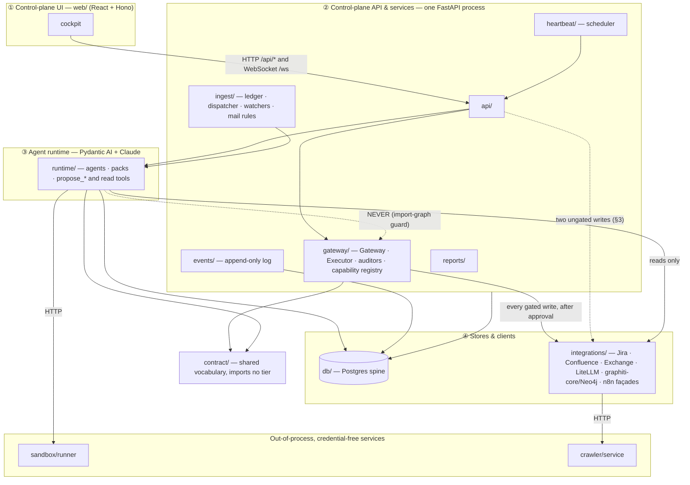
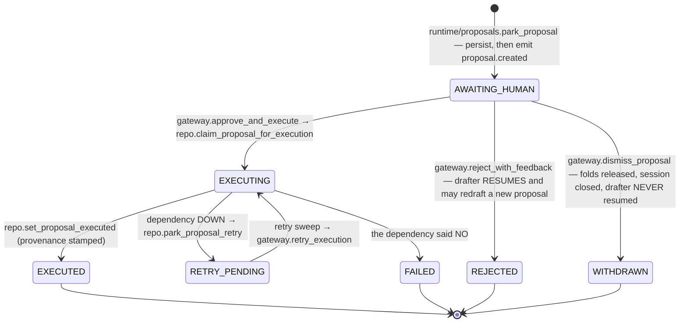

# Central Command — Architecture (the living map)

> **What this is.** How Central Command is built, **as built**: the tiers, the
> packages and what each holds, the lifecycles, the spine mechanics, the cockpit
> and the deploy surfaces. *Why* the product exists and what it must do is the
> [PRD](PRD.md) (its §3 is the glossary, its §4 the requirements); this file
> states only how, and cites the PRD for the rest. [`DESIGN.md`](DESIGN.md) is
> the *founding* design, frozen; where it and this file disagree, the code and
> this file win.
>
> **What this is not.** A rulebook. The rules, the decision log, the design
> records and the unfinished work are each routed in §8; this file links to
> them rather than restating them.
>
> **Keeping it true.** Every row below names a path. When you move or rename a
> seam, **fix the row in the same change.** That is enforced, not hoped for:
> `tests/test_architecture_doc.py` fails when a package or module is missing
> from the package map, when a named path does not exist, or when a recomputable
> count (capabilities, heartbeat action kinds, event types, state sets, cockpit
> routes, k3s manifests) no longer matches the tree. There is no version stamp
> on purpose — the guard is the verification. Anything that could not be
> verified is marked *(unverified)*, never guessed. A row about something
> deleted says "deleted in vX.Y.Z" in the same line; history is a record, not a
> claim about the tree.

## 1. The paradigm in one screen

A **modular monolith in four tiers** built around one idea: **agents propose,
a gate approves, a credentialed Executor performs** (PRD §1, §4.1). The trust
boundary is not a network hop or a permission table — it is the **Python import
graph**: `central_command/runtime/` may never import `central_command/gateway/`
(guard: `tests/test_governance.py::test_runtime_never_imports_the_gateway_tier`,
an AST walk over every runtime module).

### What each tier holds

"Holds" means code in the tier reads a credential of that kind from `config.py`
(`settings`) or the environment. The sentence the table exists to keep true:
**the runtime holds read credentials and no write path; no credential an agent
can reach changes anything.**

| Tier | Holds | Does not hold |
|---|---|---|
| ① cockpit (`web/`) | The API's address (`GATEWAY_URL`); no external credential | Anything for Jira, Confluence, mail, the graph or the model proxy |
| ② `gateway/` (Executor) | Every **write** credential: Jira, Confluence, the git forge, the n8n façades (mail, calendar), Exchange, the LiteLLM administration database and its salt key, the scoped kubeconfigs for model and MCP changes | — (this is the only tier that writes after a decision) |
| ② `api/` | The Postgres DSN; the **Neo4j bolt password** (operator graph curation through `integrations/neo4j_writer.py`, and the Graph panel's reads through `integrations/neo4j_reader.py`); the **LiteLLM proxy key** for speech (`api/speech.py`) | A credential an agent can reach: agents never call the API tier's code |
| ② `ingest/`, `heartbeat/`, `events/`, `reports/` | The Postgres DSN; `ingest/` reads mail and files through the façades; `ingest/wiki_freshness.py` holds the Confluence write used by the config-gated stale-page annotation (default off) | Any agent-directed write |
| ③ `runtime/` | **Read credentials only**: Jira, Confluence, forge, graph reads over bolt (`integrations/graphiti.py`, `neo4j_reader.py`), mail façade reads, Exchange reads, the LiteLLM proxy key for model calls and `/model/info`, the credential-store listing; the sandbox client (a mutating client against a credential-free sandbox) | A write path: no module under `runtime/` may reach a write method of a credentialed client, nor the graph write modules. Guards: `tests/test_runtime_integration_reads.py` (frozen per-client allowlist, DL-103) and `tests/test_governance.py` |
| ④ `db/`, `integrations/` | `db/`: the DSN. `integrations/`: the client for each external system, each holding its own credential | — |
| `sandbox/`, `crawler/` | **Nothing, by design** | Credentials of any kind |

**What the runtime can reach.** `runtime/` imports `integrations/` clients, and
every call it makes against a credentialed system is a *read* (Jira,
Confluence, the git forge, Graphiti, LiteLLM `/model/info`, the mail façade's
`list_refs`/`get_message`, Exchange `configured`, the credential store's
provider listing, web fetch). The one mutating client it uses is
`integrations/sandbox_client.py`, against the sandbox — which holds no
credentials by design (containment, not restriction; see AGENTS.md). Every
**gated** write method on a credentialed client is called from
`gateway/executor.py`; the two writes that are not gated are listed under
"Who may approve what" in section 3, with their callers. The read-only property
is a guard test, not an inspection: `tests/test_runtime_integration_reads.py`
walks every module under `runtime/`, resolves every name bound to an
`integrations` submodule, and checks each attribute reached through it against a
frozen per-client allowlist of confirmed reads — so a write that appears in the
runtime tier fails the suite in the commit that adds it (DL-103).

**Two intentional package cycles**, both broken with function-scoped imports
and neither crossing the forbidden edge: `api ⇄ gateway` (`api/routes.py`
imports the gateway at module level; `gateway/gateway.py` and
`gateway/executor.py` reach back into `api.orchestration` /
`api.routes.create_and_run_task` lazily) and `api ⇄ runtime` (`runtime/questions.py`
and `runtime/converse.py` lazily import resume callbacks from
`api/orchestration.py`). `heartbeat/` reaches `api/` the same lazy way but may
never import the gate. `contract/` imports nothing from `api`, `gateway` or
`runtime`; `sandbox/` and `crawler/` import nothing from `central_command` at all.

## 2. Package map

Every package and module under `central_command/`; a module that is not in its
package's rows fails the guard. "Creds" is defined in the tier table above.
Rows for the same package are grouped by what the modules are for.

| Package | Tier | Creds | What it is | Modules and key seams | Rules |
|---|---|---|---|---|---|
| `api/` | ② | DSN, bolt, speech key | The FastAPI app: JSON API, SSE stream, the cockpit's WebSocket gateway, the orchestration driver, updates, systems launchpad, attachments, speech, the readiness self-check | `app.py` (assembly), `routes.py`, `nerve_gateway.py` (`/ws`), `orchestration.py`, `backstops.py`, `hold.py`, `update.py`, `systems.py`, `attachments.py`, `speech.py`, `selfcheck.py` (`GET /api/selfcheck`, `POST /api/selfcheck/run`) | [cockpit](../.claude/rules/cockpit.md), [runtime-resilience](../.claude/rules/runtime-resilience.md) |
| `gateway/` | ② | **write** (via Executor) | The trust boundary: the one approval seam, the Executor, the capability registry (97 capabilities), the dismissal auditor, the graph auditor, deterministic policy checks, agreement records, wiki-claims capture | `gateway.py` (`approve_and_execute`, `reject_with_feedback`, `dismiss_proposal`, `retry_execution`), `executor.py` (`execute`), `capabilities.py` (`REGISTRY`), `auditor.py` (`audit_dismissal`), `graph_auditor.py`, `policy.py`, `steward_agreement.py`, `wiki_claims.py` | [AGENTS.md](../AGENTS.md) |
| `runtime/` | ③ | **read only** | The seams every run passes through: model resolution, tool surface, durable pause/resume, proposals, questions | `models.py` (`resolve_model`), `packs.py` (`toolset_for`), `tools.py` (the `propose_*` and read tools), `durable.py` (`proposal_from_call`), `proposals.py` (`park_proposal`), `run.py` (`run_task`, `run_coach`), `agent.py` (`build_agent_for`, resume only), `deps.py`, `questions.py`, `resume_park.py`, `skills.py`, `spike_model.py` (the deterministic demo and test doubles `resolve_model` swaps in under `CC_DEMO_MODE`; first built for the M2 spike) | [runtime-resilience](../.claude/rules/runtime-resilience.md), [models](../.claude/rules/models.md) |
| `runtime/` | ③ | **read only** | Conversations and teamwork: operator conversations, consults, discussions, reflection, the attention budget, accountability check-ins, first-run tour | `converse.py`, `consult.py`, `discussions.py`, `reflection.py`, `attention.py`, `accountability.py`, `tour.py`, `context.py` (context-window pressure) | [runtime-resilience](../.claude/rules/runtime-resilience.md) |
| `runtime/` | ③ | **read only** | The roster as data: how an agent joins the team, hire templates, the update hold flag | `roster.py`, `hiring.py`, `templates.py`, `hold.py` | [AGENTS.md](../AGENTS.md) |
| `runtime/` | ③ | **read only** | The agents, one module per entry point and one per built-in charter ("v0"). Several agents have no run path of their own: they are tasked (`run_task`), conversed with or consulted. Agents: EA, knowledge steward, editor, Jira expert, Confluence expert, LiteLLM manager, MCP manager, wiki agent, coach, orchestrator (a router; holds no `propose_*` tools), and the two auditors and the graph curator (charters only) | `ea.py`, `ea_profile.py`, `steward.py`, `steward_profile.py`, `editor.py`, `editor_profile.py`, `jira_expert.py`, `confluence_expert.py`, `litellm_manager.py`, `litellm_manager_profile.py`, `mcp_manager.py`, `mcp_manager_profile.py`, `wiki_agent.py`, `coach_profile.py`, `orchestrator.py`, `orchestrator_profile.py`, `auditor_profile.py`, `graph_auditor_profile.py`, `graph_curator_profile.py` | [models](../.claude/rules/models.md) |
| `contract/` | shared | none | The vocabulary both tiers speak: proposal models, status enums, `ARG_SPECS` argument shapes, `claim_supported`, the failure taxonomy (DOWN vs NO), one-click-unsubscribe eligibility | `args.py` (`ARG_SPECS`, `validate_action_args`), `models.py` (`claim_supported`), `enums.py`, `failures.py` (`is_transient`), `mail.py` | [AGENTS.md](../AGENTS.md), [integrations](../.claude/rules/integrations.md) |
| `db/` | ④ | DSN | The Postgres spine: one asyncpg access layer and the schema | `repo.py` (the access layer — nearly all SQL), `schema.sql` (auto-loaded on a **fresh** database only). SQL outside it: three advisory-lock leases (`heartbeat/engine.py`, `ingest/dispatcher.py`, `integrations/graphiti_ingest.py`), the readiness queries in `selfcheck.py`, and `integrations/litellm_credstore.py`, which reads LiteLLM's own database | [AGENTS.md](../AGENTS.md) |
| `events/` | ② | none | The append-only event log: write to Postgres, then fan out; WARNING+ log records bridged into events | `log.py` (`events.emit`, the only publish path), `bridge.py` | [AGENTS.md](../AGENTS.md) |
| `ingest/` | ② | read (mail, files); Confluence write for the gated-by-config annotation | Feeds and the dispatcher: the Work Ledger, the live mail feed, backlog enrollment, the backpressure dispatcher, standing mail rules applied before any model call | `ledger.py` (`enroll_*`, `hydrate_work_item`), `feed.py` (`poll_once`), `dispatcher.py` (`process_claimed`, the one path every item takes), `mail_rules.py` (rules applied before the model; `mail.create_rule` is gated), `mailtext.py` (the one mail-body converter) | [integrations](../.claude/rules/integrations.md), [`QUEUE.md`](QUEUE.md) |
| `ingest/` | ② | as above | The sources catalog and bulk actions: filesystem watcher, text extraction (the markitdown seam shared with chat attachments), catalog enrollment, bulk dismissal, the wiki freshness sweep | `watcher.py`, `extract.py`, `catalog_enroll.py`, `bulk_dismiss.py`, `wiki_freshness.py` | [integrations](../.claude/rules/integrations.md) |
| `heartbeat/` | ② | none | The scheduler for recurring team work: tick loop, action registry, dependency-health probes | `engine.py` (`fire`, one firing path for tick and run-now), `actions.py` (`ActionSpec`, 12 action kinds), `probes.py` | [runtime-resilience](../.claude/rules/runtime-resilience.md) |
| `integrations/` | ④ | each client holds its own | **Native clients**: Jira, Confluence, the git forge, LiteLLM (proxy) and its credential store, the Exchange (EWS) mail client, Neo4j (reads and the closed curation write set) | `jira.py`, `confluence.py`, `forge.py`, `litellm.py`, `litellm_credstore.py`, `exchange.py`, `neo4j_reader.py`, `neo4j_writer.py` | [integrations](../.claude/rules/integrations.md) |
| `integrations/` | ④ | as above | **graphiti-core, in-process** (no server): `graphiti.py` reads (the one graph module `runtime/` may import; it imports graphiti-core search modules function-locally, after the client has prepared the environment), `graphiti_client.py` is the one place the library is built and configured, `graphiti_ingest.py` is the durable ingest queue's worker, `graph_ontology.py` holds the ten entity types, `graphiti_patches.py` applies the two carried graphiti-core fixes | `graphiti.py`, `graphiti_client.py`, `graphiti_ingest.py`, `graph_ontology.py`, `graphiti_patches.py` | [graph](../.claude/rules/graph.md), [models](../.claude/rules/models.md) |
| `integrations/` | ④ | n8n holds the OAuth | **n8n façades** for mail and calendar (n8n holds the OAuth; the Jira façade fallback was removed in v2.50.0). **Uncredentialed**: web fetch, the crawler client, the sandbox client. `http.py` is the pluggable-trust httpx factory (CA bundle / mTLS) | `email_facade.py`, `calendar_facade.py`, `webfetch.py`, `crawler.py`, `sandbox_client.py`, `http.py` | [integrations](../.claude/rules/integrations.md) |
| `reports/` | ② | none | Deterministic, judgment-free reads composed from the spine: the EA's snapshot, the operator's calendar day, the EA's open follow-ups; called only from `runtime/tools.py` and `heartbeat/actions.py` | `ea_report.py`, `ea_calendar.py`, `ea_followups.py` | — |
| `sandbox/` | out-of-process | **none, by design** | A standalone FastAPI service giving agents a disposable workspace. Two backends behind one API: `kubectl` (a gVisor Job+Pod per session) or `podman` (a container per session). Never imported; reached only through `integrations/sandbox_client.py`. Its single exit is the gated `mcp.sync_source`, content captured at propose time | `runner.py` | [AGENTS.md](../AGENTS.md) |
| `crawler/` | out-of-process | none | A standalone browser-rendering crawl service for whole-site documentation import. Never imported; reached through `integrations/crawler.py`, whose only caller is `skills/site_import.py` | `service.py` | — |
| `skills/` | ②/③ | none | The skills library's import side: `SKILL.md` + references → DB rows and a chunked search index (`chunking.py`); whole-site import | `importer.py`, `site_import.py`, `ids.py`, `chunking.py` | — |

Top-level modules of `central_command/`: `config.py` holds every `CC_*` setting
(`settings`), with its comment as documentation; `selfcheck.py` is the
application self-check — the install proved as the app, one implementation run
from the command line (`python -m central_command.selfcheck`) and from
`api/selfcheck.py`; it reads the spine directly and reports readiness only.

### The parts `DESIGN.md` does not describe

- **`api/backstops.py` is the task-create seam's provenance and loop breaker.**
  `routes.create_and_run_task` is the one task-create path; the `task` row
  records `created_by` (`operator` | `heartbeat:<schedule>` | `agent:<id>`;
  NULL on older rows, read as operator), `approved_by` (the approver of a
  gated `task.create`; the event `actor` stays the approver), `parent_task_id`
  and `creator_chain` (agent ids, root first, including the immediate creator).
  All are derived server-side from `parent_session_id` — the creator from the
  session row, the parent task from `repo.task_for_session` — never from tool
  arguments. A creation whose chain would exceed `task_max_depth` (default 3:
  agent-created tasks in the lineage including the new one), or an
  agent-created task naming no assignee, writes no row, emits `task.refused`
  (`ref_id` the parent task, else the creating session; payload `reason`,
  `chain`, `creator`, `agent_id`) and returns a 422 naming the reason.
- **`api/orchestration.py` is a driver; `runtime/orchestrator.py` is an agent.**
  The agent holds no `propose_*` tools — it recommends routing and changes
  nothing. The driver (tier ②) runs multi-agent *projects* as a durable plan →
  assign → receive → decide loop: it parks on deferred tool batches, creates
  child tasks, and resumes after decisions (`run_project`, `maybe_resume`,
  `resume_sweep`, `resume_parked_session`, `resume_consult_wait`,
  `resume_task_wait`, `retry_parked_task`, `continue_session`). It is also where
  the retry sweep lives (`retry_sweep`), because that sweep must reach
  `gateway.retry_execution`.
- **`api/nerve_gateway.py`** answers the cockpit's gateway wire protocol
  (request/response/event frames over WebSocket at `/ws`). It is a
  read-and-plumbing surface; writes go through the same gateway functions the
  HTTP routes call.
- **`api/hold.py`** is the update hold: pause the team, wait for in-flight
  agent work to land, then trigger the updater. The flag the runtime reads is
  `runtime/hold.py`, in memory on purpose.
- **`api/update.py`** serves the single-node profile's version check and
  upload/apply/status routes; the k3s profile's updater is driven from the
  cockpit server (`web/server/routes/cc-update.ts`) through systemd path units.
- **`gateway/capabilities.py`** is "executable truth": each `Capability` row
  carries `kind`, `gate`, `risk` (free text — what a wrong use costs),
  `holder`, `route` and `arguments`. Agent charters' capability sections are
  *generated* from pack grants over this registry at run start.
- **The Executor replays by cursor.** The completed-actions list is the
  cursor, so a half-landed non-idempotent write may be applied twice on retry;
  façade idempotency keys are the owed fix (PRD §6.2).

## 3. Lifecycles, as built

### Wake sources

An agent run starts from exactly **three** sources: the **heartbeat** scheduler
(`heartbeat/engine.py` firing a governed schedule row), the **ledger
dispatcher** (`ingest/dispatcher.py` claiming a work item), and **direct
tasking** (the operator, or a task created by an action, through
`create_and_run_task`). There is no event-subscription wake and no
agent-to-agent request event: collaboration is a **consult** (the asker parks
`AWAITING_AGENTS`) or a **task**.

### Proposal

- **Before the gate.** A `propose_*` tool validates argument shape against
  `contract.ARG_SPECS` (a malformed draft goes back to the model as a
  `ModelRetry`, up to `max_retries=10`), then the run pauses at a deferred call
  and `park_proposal` is the one path into the queue.
- **At the gate.** `proposal.decided` is emitted inside
  `approve_and_execute` *before* `executor.execute()` runs. The Executor
  re-runs the same shape validation over every action before the first one
  runs, then world-state checks, then the handlers; `proposer` comes from the
  gateway, never from the agent's arguments.
- **Operator routes.** `POST /proposals/{id}/approve | reject | dismiss`
  (`api/routes.py`); the cockpit reaches the same gateway functions over `/ws`.
- **Folds.** Sibling work items folded into a proposal sit in `FOLD_PENDING`;
  they go terminal (`FOLDED`) only when the covering proposal executes
  (`repo.commit_folds`) and return to `UNPROCESSED` on reject, dismiss or failure.
- **Founding states that were never built.** `DESIGN.md` §2 lists DRAFT,
  UNDER_AUDIT, AUTO_APPROVED, STALE and EXPIRED; none exists in code.
  `ProposalStatus.proposed` is only the in-memory default of a proposal
  record before it is parked — it is never persisted (rows begin at
  `AWAITING_HUMAN`); `ProposalStatus.approved` is declared and tolerated in a
  few `status in (...)` reads but never assigned.

### Who may approve what

Every gated world-change passes **one seam** (`gateway.approve_and_execute`).
What varies is the approver.

| Category | Approver | Classes today | Switch (default) |
|---|---|---|---|
| **Human gate** — the baseline for everything | the operator | every capability whose `gate` is human approval: Jira, Confluence, calendar, mail, graph episodes and curation proposals, charter edits, MCP sync, model configuration, … | — |
| **Graduated class** — the independent auditor re-derives the judgment from the raw source; a **CONCUR** executes with `approver="auditor"`, a **CHALLENGE** or an auditor error parks for the operator | the auditor, per class, revocable | `dismissal.confirm` (email dismissals) and `work.bulk_dismiss`; `dismissal.confirm.document`; graph-verification rows that are aligned, mechanically clean and addition-only (invalidations always park) | `CC_AUDITOR_ENABLED` (false) + `CC_AUDITOR_MODE` (shadow); `CC_AUDITOR_DOCUMENT_MODE` (shadow); `CC_GRAPH_AUDITOR_ENABLED` (false) + `CC_GRAPH_AUDITOR_MODE` (shadow) |
| **Ungated deterministic write** — exactly two, no proposal, because there is no agent judgment to review | code, or the operator's own click | (1) operator graph curation: a closed write set in `integrations/neo4j_writer.py`, called from `api/routes.py` for the operator's own edits; (2) wiki stale-page annotation: a deterministic template over claim rows, no model in the path, whose Confluence write is made by `ingest/wiki_freshness.py` | — ; `CC_WIKI_ANNOTATION_MODE` (off) |

These two are the closed exemption list the PRD's override requirement (FR-4)
generalises. Graduation is **configuration, never code**, one class at a time,
on recorded agreement evidence (`gateway/auditor.py`,
`gateway/steward_agreement.py`, `gateway/graph_auditor.py`); a fresh install is
fully human-gated. Doctrine:
[trust-tier graduation](superpowers/specs/2026-07-30-trust-tier-graduation-design.md);
decisions: [`decisions/trust-gate.md`](decisions/trust-gate.md).

### Session

`session.status` is free text in `schema.sql` on purpose (a new wait state needs
awareness in its readers, never a migration). The values in use:

```mermaid
stateDiagram-v2
    [*] --> RUNNING
    RUNNING --> AWAITING_HUMAN: a propose_* call deferred
    AWAITING_HUMAN --> RUNNING: verdict recorded → resume
    RUNNING --> AWAITING_OPERATOR: conversation between turns
    AWAITING_OPERATOR --> RUNNING: operator message
    AWAITING_OPERATOR --> DONE: conversation ended (status flip; transcript kept)
    RUNNING --> AWAITING_AGENTS: waiting on child tasks or a consult
    AWAITING_AGENTS --> RUNNING: children landed
    RUNNING --> AWAITING_RESUME: resume leg failed transiently (resume_park)
    AWAITING_RESUME --> RUNNING: retry sweep, health-gated
    RUNNING --> AWAITING_CONTINUE: request window spent — never auto-driven
    RUNNING --> STOPPED: operator stop — never auto-driven
    AWAITING_CONTINUE --> RUNNING: operator continues
    STOPPED --> RUNNING: operator resumes
    RUNNING --> DONE
    RUNNING --> FAILED: always with a recorded reason
    DONE --> [*]
    FAILED --> [*]
```

`contract/enums.py::SessionStatus` is a narrower, older list (it still names
`AWAITING_INPUT` and `ABORTED`, which nothing sets); the schema comment is the
authority. Sessions are never deleted, and one agent may hold several at once.

### State sets

One table, checked against the schema comments and `contract/enums.py` by the
guard (`ProposalStatus.proposed` and `.approved` are the two enum values never
persisted, above).

| Entity | States |
|---|---|
| Session | RUNNING, AWAITING_HUMAN, AWAITING_OPERATOR, AWAITING_AGENTS, AWAITING_RESUME, AWAITING_CONTINUE, STOPPED, DONE, FAILED |
| Proposal | AWAITING_HUMAN, REJECTED, EXECUTING, EXECUTED, FAILED, RETRY_PENDING, WITHDRAWN |
| Task | NEW, ASSIGNED, IN_PROGRESS, REVIEW, DONE, FAILED, CANCELLED |
| Work item | UNPROCESSED, CLAIMED, FOLD_PENDING, DISMISS_PENDING, PROCESSED, FOLDED, FAILED |
| Guidance | CURRENT, SUPERSEDED |

The task flow is `NEW → ASSIGNED → IN_PROGRESS → REVIEW → DONE | FAILED |
CANCELLED` (the founding design's `BLOCKED` was never built); a work item runs
`UNPROCESSED → CLAIMED → (FOLD_PENDING | DISMISS_PENDING) → PROCESSED | FOLDED |
FAILED`. Guidance has exactly one `CURRENT` version per agent (a partial unique
index in `schema.sql`); history is kept as `SUPERSEDED`.

## 4. Spine mechanics

- **Event log.** `events.emit()` writes the row to Postgres, then fans out to
  in-process subscribers; the SSE stream (`GET` stream route in
  `api/routes.py`) and the cockpit's `/ws` push frames are projections of the
  table, never a parallel channel. 167 distinct event types are emitted today
  (recounted from `emit(...)` call sites by the guard; dynamic kinds such as
  bridged log records are not counted). Ordering rule: an event that
  *authorises* something is written before the thing it authorises.
- **Heartbeat.** Schedules are governed rows (`cron` | `every` | `at`), one
  heartbeat per database via an advisory lock, missed fires skipped rather than
  replayed. 12 action kinds: `feed.poll`, `dispatch.window`, `source.walk`,
  `wiki.freshness`, `task.create`, `report.audit_agreement`,
  `discussion.sweep`, `retry.sweep`, `graph.verify_sweep`,
  `sandbox.run_script`, `ea.contact`, `litellm.discovery`. An action never
  awaits agent work; an action may be "quiet" (writes nothing when immaterial)
  only via the `ActionSpec.material` allowlist.
- **Ingest.** Feed or watcher → `ledger.enroll_*` (`UNPROCESSED`) →
  dispatcher claim → `dispatcher.process_claimed()` → agent run → terminal
  state; standing mail rules (`ingest/mail_rules.py`) run before any model
  call. Valves: concurrency, the approval-coupled throttle (don't outrun
  review), token budget (retired by decision, PRD FR-24; the knob stays until its removal ships), max attempts. Dispatch is opt-in. Operations and
  defaults: [`QUEUE.md`](QUEUE.md).
- **Outage equivalence.** A dependency that is DOWN costs latency, never work:
  `contract/failures.py` classifies, sessions park `AWAITING_RESUME`,
  proposals park `RETRY_PENDING`, tasks retry-park, and the health-gated
  `retry.sweep` converges all three
  ([spec](superpowers/specs/2026-07-31-outage-equivalence-design.md)). That
  holds for model calls and approved executions. A DOWN *live read* by an agent
  (graph, calendar, Jira) is still best-effort today and degrades inside the
  tool result; PRD FR-40 makes it park, which is on the build list (§6.1).
- **Durability.** A paused run is the deferred-tool pattern plus the project's
  own persisted message history (`runtime/durable.py`); DBOS was never adopted.
  `system_prompt=` is persisted into that history on purpose (AGENTS.md).
- **Models.** Everything addresses a `cc-*` role alias through the LiteLLM
  proxy on a configured deployment; `runtime/models.resolve_model()` is the one
  seam (and where `CC_DEMO_MODE` swaps in the deterministic model). The alias
  is a deployment fact, not a code default. See
  [models rules](../.claude/rules/models.md).
- **Knowledge graph.** graphiti-core runs inside the API process, imported only
  after `graphiti_client.py` has prepared the environment. Agents read the graph
  in-process (searches and episode listings, over bolt) and write only by gated
  `graph.add_episode` proposals into scoped partitions: approval queues a
  durable `graph_ingest_job`, and the worker extracts it afterwards, strictly in
  order per group, behind one worker lease per database. The cockpit's Graph
  panel reads Neo4j directly over bolt through the API tier. The rule `runtime/`
  lives under is that it holds no WRITE path — not that it holds no bolt
  (DL-134). See [graph rules](../.claude/rules/graph.md).

## 5. The cockpit (`web/`)

A vendored fork of openclaw-nerve (React client, Hono server); provenance and
the quarantine list are in [`web/VENDORED.md`](../web/VENDORED.md).

- **Ours:** `web/server/routes/cc-*.ts`, and the Central Command screens under
  `web/src/features/` (VENDORED.md names which). **Ignore:**
  `web/vendor-unused/`, `web/docs/`, `web/.github/`. `web/server/app.ts` is the
  authority on which routes are live; the upstream routes it also mounts
  (auth, files, workspace, TTS and transcription, and others) are not ours.
- **Feature directories** under `web/src/features/`: `activity`, `agents`,
  `attention`, `auth`, `beads`, `charts`, `chat`, `command-palette`, `connect`,
  `dashboard`, `decisions`, `file-browser`, `graph`, `graph-verifications`,
  `kanban`, `loe`, `markdown`, `memory`, `notifications`, `sessions`,
  `settings`, `skills`, `sources`, `systems`, `tts`, `voice`, `workspace`.
- **Two channels to the API.** (1) Every `cc-*` route is a thin HTTP proxy:
  `fetch(config.gatewayUrl + "/api" + path)`. (2) Chat, sessions and all live
  push ride a WebSocket: the browser connects to the cockpit server's `/ws`
  (`web/server/lib/ws-proxy.ts`), which relays to the `/ws` that **FastAPI
  serves** (`api/nerve_gateway.py`) by answering the wire protocol the upstream
  client already speaks. The Hono server's own SSE endpoint
  (`web/server/routes/events.ts`) carries the cockpit server's local events
  (`memory.changed` from its file watcher, `tokens.updated`, `status.changed`
  and keep-alives), not the API's event log; `web/server/lib/gateway-rpc.ts` is
  upstream's workspace-file fallback client, not part of this seam.
- **Defaults.** Cockpit server on 3080 (`web/server/lib/constants.ts`); API on
  8080. The vendored default gateway URL does **not** point at the API —
  `GATEWAY_URL` in the cockpit server's env file must, or every `cc-*` route
  returns 502.
- **Build.** `npm run build` → client bundle plus the compiled cockpit server (`server-dist`); its
  `build:server` step starts with `rm -rf server-dist`, so a removed source
  cannot linger there (a bare `tsc` would leave it).
  Tests: `npm test` (vitest).

| Cockpit route | Proxies to (FastAPI) |
|---|---|
| `cc-kanban` | tasks (`/api/kanban/*`) |
| `cc-crons` | heartbeat schedules (`/api/crons*`) |
| `cc-memories` | graph episodes |
| `cc-tokens` | usage |
| `cc-activity` | activity overview, sessions, events, work-item requeue |
| `cc-charter` | agent charters |
| `cc-graph` | graph search / neighbourhood / provenance / status |
| `cc-loe` | level-of-effort |
| `cc-skills` | skills import (doc, file, site) |
| `cc-decisions` | bulk dismissal preview and submit |
| `cc-sources` | sources and the catalog |
| `cc-systems` | systems launchpad, API docs, the self-check (`/api/selfcheck`) |
| `cc-mail-rules` | standing mail rules and their preview (`/api/cc/mail-rules`) |
| `cc-update`, `cc-update-proxy` | update status / stage / apply / hold |
| `cc-context` | context-window settings |

## 6. Deploy surfaces

| Surface | What it is | Entry points | Read first |
|---|---|---|---|
| `deploy/single/` | Single-node profile on Compose (`compose.yaml`). Unconditional services: postgres, litellm with its db and redis, neo4j; behind profiles: n8n (with its db), the crawler and speech. Deterministic driver: its phases and steps are declared once, in `steps.tsv` (run order), and recorded in a ledger as each completes; the operator's procedure is the generated [`CHECKLIST.md`](../deploy/single/CHECKLIST.md); exit codes 0/1/2/3 (3 = stopped for the operator) | `setup.sh`, `update.sh` (`init` · `import` · `stage` · `plan` · `apply` · `rollback`), `resolve-images.sh` + `images.txt` (constraint / locked tag / locked digest) | [`deploy/single/README.md`](../deploy/single/README.md), [deploy-single rules](../.claude/rules/deploy-single.md) |
| `deploy/k3s/` | Multi-node profile: numbered manifests `00-namespace`, `20-postgres`, `30-litellm`, `31-litellm-rbac`, `40-graph`, `50-n8n`, `60-sandbox`, `61-mcp`, `70-crawler`, `80-vlogs`, `85-pgweb`, `90-speech`; placement split by state (stateful pinned, stateless floats), services exposed on loopback, the API / cockpit / sandbox-runner as systemd units outside the cluster. Same driver contract, six phases: validate · preflight · llm · stack · app · verify | `setup.sh`, `verify.sh`, `cc-update.sh`, `backup.sh`, `make-secrets.sh`, `mint-keys.sh`, `build-*-image.sh` | [`deploy/k3s/README.md`](../deploy/k3s/README.md), [deploy-k3s rules](../.claude/rules/deploy-k3s.md) |
| `deploy/shared/` | Assets both deployment substrates read: `litellm/` — `register-models.py` (run by both installers), `policy.py`/`checks.sh` and the k3s profile's declared LiteLLM policy (`config.yaml`, `model-preferences.yaml`; the single profile's equivalents are `deploy/single/litellm-config.yaml` and `deploy/single/models.json`). `gateway/executor.py` and `runtime/tools.py` name these files by path | — | [`deploy/shared/README.md`](../deploy/shared/README.md) |
| `deploy/n8n/` | The mail and calendar façade workflows as code; applied by both updaters | `apply-workflows.sh` | [`deploy/n8n/README.md`](../deploy/n8n/README.md) |
| `deploy/discover.sh`, `deploy/AIRGAP.md` | Environment discovery and the mirror / CA / proxy seams for restricted networks (`deploy/env-lib.sh` maps the answers to settings). Registry mirrors are per-upstream: `CC_REGISTRY_DOCKERIO`, `CC_REGISTRY_GHCR`, `CC_REGISTRY_MCR` | `discover.sh` | [`deploy/AIRGAP.md`](../deploy/AIRGAP.md) — **first**, for any mirrored or no-egress install |
| `deploy/graphiti-patches/` | The two graphiti-core fixes the project carries, as patch files; applied to the installed package by `integrations/graphiti_patches.py` (`scripts/apply_graphiti_patches.py` at install time), pinned and checked at ingest | — | [graph rules](../.claude/rules/graph.md) |
| `deploy/desktop-superseded/` | History only; nothing references it | — | — |
| `docker-compose.yml` (root) | The dev database only: `cc-postgres` on 127.0.0.1:**5442** with the schema auto-loaded | `docker compose up -d postgres` | [AGENTS.md](../AGENTS.md) |

**The k3s updater** (`cc-update.sh`), in order: resolve → version gate
(`min_upgrade_from`) → busy check → rollback checkpoint → prebuild changed
images (services stay up) → database dumps → stop → merge → additive schema →
rebuild venv and cockpit → manifests and units → n8n workflows → reconcile app
config → start services → health → roll back on failure. It reads `VERSION` for
the installed version, not git. `kubectl apply` never deletes, so a removed
manifest must be tombstoned in `deploy/k3s/removed.txt`; a changed updater unit
takes effect on the *next* run.

Other top-level directories: `scripts/` (pre-push guard, vendored-docs and
model-library fetchers, `graph_inspect.py`, `render_checklist.py`, the M2
spike and M5 live acceptance, evals runner, `oneoff/`), `skills/` (the shipped
skill packs), `servers/` (MCP servers — arrive only through an approved
`mcp.sync_source`), `evals/`, `fixtures/`, `docs/vendor/` (fetched, never
hand-edited).

## 7. Id index — what M- and D-numbers mean

Code comments cite these; this is where they resolve.

### Milestones (the founding build order)

| Id | Meaning | Lives in |
|---|---|---|
| M0 | Scaffolding: package, schema, contract models, API health check | `central_command/`, `db/schema.sql` |
| M1 | The Proposal/Action contract round-trips cleanly | `contract/`, `tests/test_contract.py` |
| M2 | Durable pause: a deferred proposal survives a full process restart (deferred tool call + persisted message history — not DBOS) | `runtime/durable.py`, `scripts/m2_spike.py` |
| M3 | The Executor: first real write against a reversible target | `gateway/executor.py` |
| M4 | The control-plane API and dashboard | `api/routes.py` |
| M5 | Live end-to-end acceptance (real model, real write; spends money) | `scripts/m5_acceptance.py` |
| M6 | The Work Ledger | `ingest/ledger.py`, `db/schema.sql` |
| M7 | The backpressure dispatcher | `ingest/dispatcher.py` |
| M8 | The event log | `events/log.py` |
| M9 | Run context (`deps`) and the thread-lock/fold gap closed | `runtime/deps.py` |
| M10 | The knowledge-graph write path | `integrations/graphiti_ingest.py` (originally `integrations/graphiti.py`), `tests/test_graph.py` |
| M11 | Coaching without deploys: governed charter versions; skills as rows | `runtime/skills.py`, `db/schema.sql` |
| M12 | The live email feed | `ingest/feed.py` |
| M13 | Backlog sweep: refs-only enrollment, content at claim time | `ingest/ledger.py` |
| M14 | Dismissal review | `tests/test_dismissal.py` |
| M15 | Sessions are never destroyed | `runtime/converse.py`, `db/repo.py` |
| M16 | The capability registry and packs that cannot drift from it | `gateway/capabilities.py`, `tests/test_packs.py` |

### Founding decisions (`DESIGN.md` D1–D22, extended in code to D27)

| Id | Meaning | Status |
|---|---|---|
| D1 | Employment models: EA / standing-guidance / direct-tasked | standing |
| D5 | The coaching loop: charter edits are proposed and gated | standing, built (stage 5a) |
| D7 | Orchestration is a role, not the EA | the role stands and is built; the founding star shape (only the operator delegates) is reversed by PRD FR-19 (not yet built; DL-170) |
| D8 | The independent auditor | standing, built |
| D9 | Jira and Confluence stay the systems of record | standing |
| D11 → D11-r1 | No ungoverned private agent memory; revised 2026-08-01 to allow a *gated* per-agent graph partition | revised |
| D12 | Auditor rollout: shadow first, graduate per action class | standing, built |
| D13 | Mail bodies referenced and re-fetched, never stored | **reversed** — converted once and persisted ([decision log](decisions/ingest-integrations.md)) |
| D15–D16 | Dispatcher valves | D15 standing, built; D16's guaranteed backlog trickle was never built (DL-152) and the token-budget valve is retired (PRD FR-24; DL-148) |
| D17 | Thread-aware batching and folds | standing, built |
| D18 | Agent-version lifecycle and replay | deferred, not built |
| D19–D21 | Sandboxing / egress allowlists / vault / anomaly detection cut from the MVP | cut — though an agent sandbox was later built as *containment* |
| D22 | Runtime = Pydantic AI + Claude (+ DBOS) | standing; DBOS never adopted (the M2 finding) |
| D23 | Native client unless n8n already solved the integration | standing |
| D24 | The roster is data (`agent` rows; hire/retire are operator actions) | standing |
| D25 | The tool surface and charter capability list are generated from pack grants | standing |
| D26 | `packs.toolset_for()` is the one tool-surface assembly seam | standing (cited once) |
| D27 | The heartbeat scheduler | standing |

D2–D4, D6, D10 and D14 were entries in the founding *open-decisions register*
rather than architecture decisions, which is why no code cites a definition:
D2 the starting agent roster · D3 v1 scope = the walking skeleton (done,
Phase 1) · D4 how proactive the EA is on day one · D6 next-step fidelity ·
D10 heartbeat cadence and EA scope (now schedule rows, D27) · D14 the
document-retrieval vector store choice. D19–D21 were recorded there as
*process isolation + credential split*, *no egress policy* and *reuse the
integration tool's credential isolation*.

### Local namespaces — same numbers, different meanings

| Where you see it | It means | Owner |
|---|---|---|
| "D1"–"D5" in `deploy/single/` and deploy docs | Compose substrate / version pins / update pipeline / Helm / Zarf-not-adopted | [deploy-refactor spec](superpowers/specs/2026-09-03-deploy-refactor-design.md) |
| "Decision 9" in `gateway/wiki_claims.py`, `ingest/wiki_freshness.py`, `schema.sql` | Wiki claims: the wiki forgets deterministically | [sources-catalog spec](superpowers/specs/2026-08-23-sources-catalog-design.md) |
| "Decision 1–6", "Decision 1–5" | Local to the [expert-team-scaling](superpowers/specs/2026-08-22-expert-team-scaling-design.md) and [teaming doctrine](superpowers/specs/2026-07-29-teaming-consultation-doctrine-design.md) specs; not cited elsewhere | those specs |
| "D9 / Story 2.1 / AR-9" in the retired Graphiti image's files (`deploy/pi/graphiti/`, deleted in v2.61.0; the whole `deploy/pi/` tree went in v2.67.0) | A pre-public numbering for the Graphiti LLM-client choice — **not** founding D9 *(origin lost: no surviving document defines that Story/AR scheme)* | — |
| `D-sandbox`, `D-web-read`, `D-confluence`, `D-graph-inspect` | Named, unnumbered decisions; each resolves to the design record of the same topic | [`superpowers/README.md`](superpowers/README.md) |
| "D1–D12" with 2026-09-19/20 dates | The 2026-09 consistency audit's operator decisions; the durable ones are in the [decision log](decisions/README.md) | — |

New work should cite a decision-log id (`DL-nnn`) or a record path, not mint
another D-number.

## 8. Where to read next

| You want | Read |
|---|---|
| Why the product exists, who it is for, what it must do, the glossary | [`PRD.md`](PRD.md) |
| The rules you must not break | [`AGENTS.md`](../AGENTS.md), then the [`.claude/rules/`](../.claude/rules/) file for the area |
| Why a rule exists, and what guards it | [`decisions/README.md`](decisions/README.md) |
| What a design record became | [`superpowers/README.md`](superpowers/README.md) |
| What is unfinished | [`ROADMAP.md`](ROADMAP.md) |
| Queue operations | [`QUEUE.md`](QUEUE.md) |
| What changed, release by release | [`CHANGELOG.md`](../CHANGELOG.md) |
| The founding intent | [`DESIGN.md`](DESIGN.md) |
