# Data model

This page is generated from `central_command/db/schema.sql` by `scripts/gen_data_model_diagram.py`. Do not edit it by hand: change the schema (or the area and purpose lists at the top of the script) and run `python scripts/gen_data_model_diagram.py` to regenerate it.

Each diagram covers one area and shows a table's primary-key, foreign-key and main state columns only. Only foreign keys declared in the schema are drawn; a table from another area appears as a bare entity. A text column that holds another table's id without a declared foreign key is not drawn.

## Agents, charters and grants

The roster (an agent row is a roster entry), the versioned charters each agent runs under, and the capability packs granted to it.

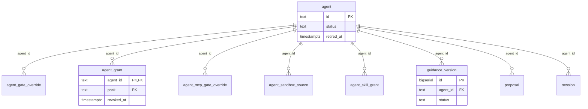

## Sessions and tasks

Agent runs with their durable transcript, the tasks that start them, the asks an agent puts to the operator, and the derived full-text recall index.

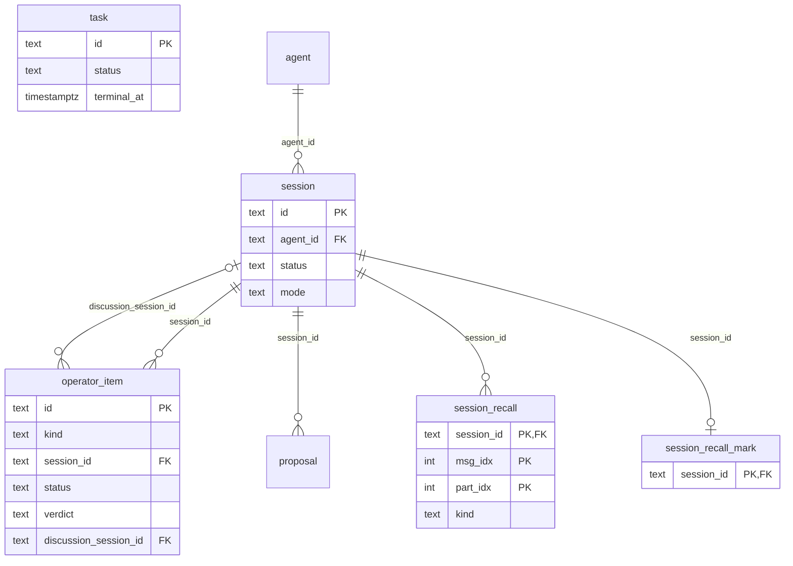

## Proposals and approval gates

Every world-changing action is a proposal awaiting a decision; gate overrides are the operator's standing relaxation of that gate for one agent and one capability.

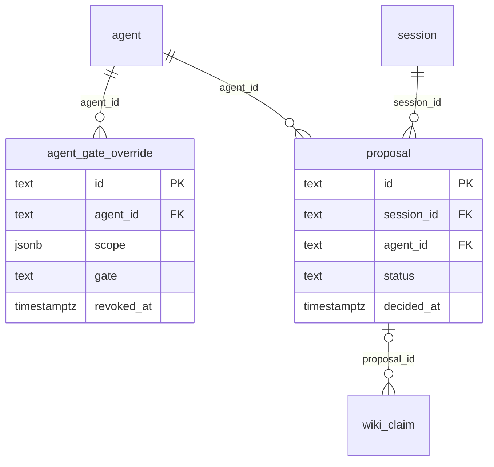

## Work ledger and mail

The durable per-item ledger that mail and documents enter through, the standing mail rules applied before any model call, and resumable feed cursors.

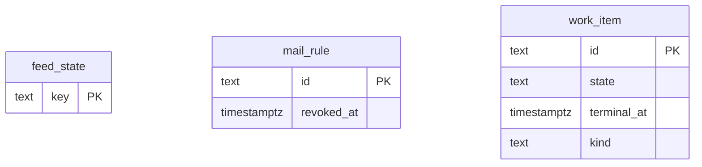

## Events, audit and outage state

The append-only event log and the persisted result of the dependency probes that drive outage recovery.

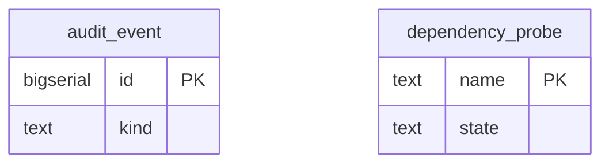

## Schedules and settings

Recurring team work held as data, and the small key/value store for operator settings.

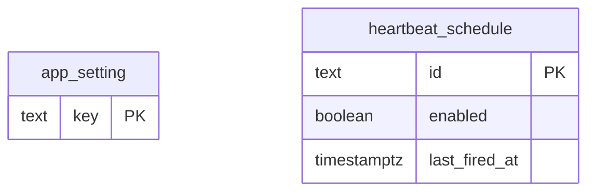

## MCP servers and sandbox

MCP servers the system knows about, their discoverable tools, per-agent gate overrides on those tools, and the sources an agent may copy into its sandbox.

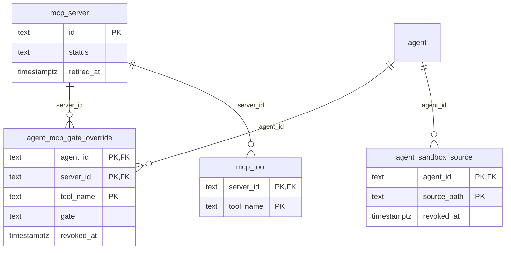

## Skills library

Curated subject knowledge held as governed, versioned data, granted per agent, plus the bookkeeping that compares each release's bundled docs with it.

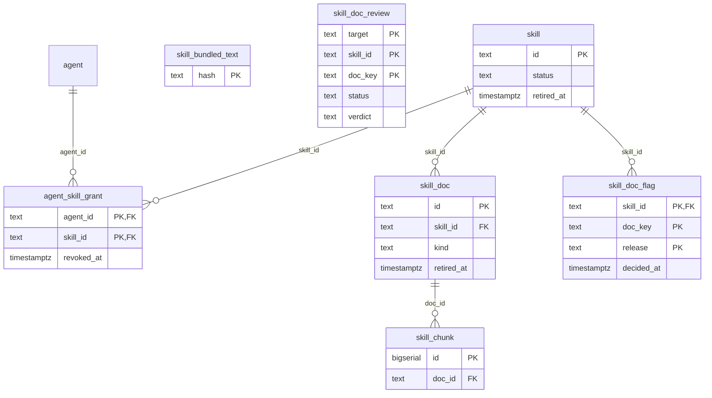

## Goals (lines of effort)

The operator's goal-tracking substrate: lines of effort, their append-only check-ins, and the archived versions of each line's scoring semantics; the calendar plan ledger of the work blocks and placeholders the assistant created or adopted; and the stored day plans with the outcomes the evening review recorded.

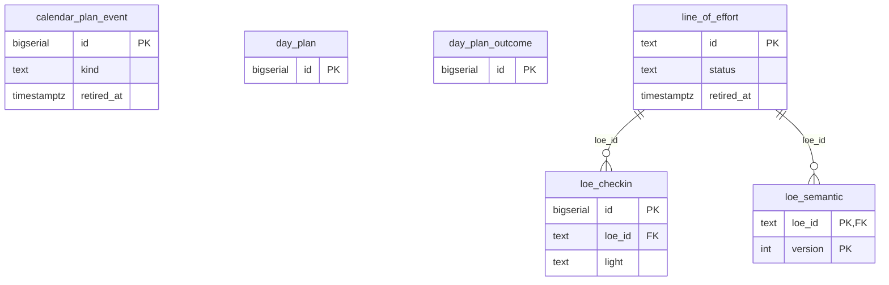

## Knowledge graph and notes

The audit and ingest queue behind approved knowledge-graph episodes, and the small always-in-context note store.

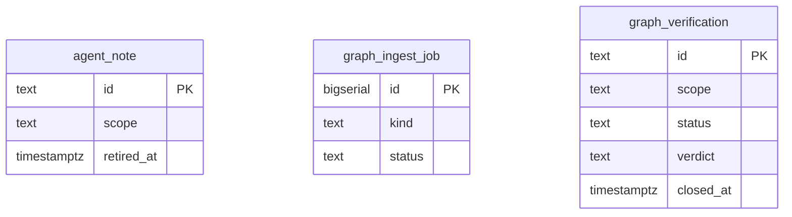

## Source catalog

Sources, the documents found in them with their versions and locations, and the evidence ledger behind wiki claims.

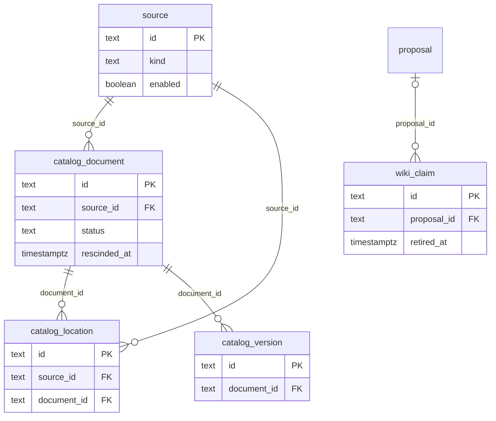

## All tables

| Table | Area | Purpose |
| --- | --- | --- |
| `agent` | Agents, charters and grants | The roster entry for an agent: lane flags, lifecycle status, model and thinking settings. |
| `agent_grant` | Agents, charters and grants | Which capability packs each agent holds; revocation is a timestamp, never a delete. |
| `guidance_version` | Agents, charters and grants | Versioned charters: exactly one CURRENT version per agent, history immutable. |
| `operator_item` | Sessions and tasks | An agent's ask of the operator (plan review, question, stall, continue) answered in the Decisions Inbox. |
| `session` | Sessions and tasks | One agent run with its serialized run state, status and lineage (a conversation or a one-shot). |
| `session_recall` | Sessions and tasks | Derived full-text index of message parts from an agent's own past sessions; rebuildable. |
| `session_recall_mark` | Sessions and tasks | Per-session indexing watermark for the recall index. |
| `task` | Sessions and tasks | An operator- or agent-created unit of work for the team, resolved when its session does. |
| `agent_gate_override` | Proposals and approval gates | The operator's standing relaxation of one capability's gate for one agent, scoped and revocable. |
| `proposal` | Proposals and approval gates | A drafted world change (actions and evidence) awaiting an approve, reject or dismiss decision. |
| `feed_state` | Work ledger and mail | Durable cursors for resumable sweeps; correctness never depends on it. |
| `mail_rule` | Work ledger and mail | Standing inbox rules that auto-dismiss matching mail before any model call, applied in position order. |
| `work_item` | Work ledger and mail | The Work Ledger: one durable row per email or document, the source of truth for what still needs doing. |
| `audit_event` | Events, audit and outage state | The append-only event log: one ordered record serving audit, observability and the live stream. |
| `dependency_probe` | Events, audit and outage state | Persisted up/down result of each dependency probe, written only when the state changes. |
| `app_setting` | Schedules and settings | Small key/value store for operator-facing settings and once-per-database seed markers. |
| `heartbeat_schedule` | Schedules and settings | Recurring team work as data: a time rule plus an action from the closed registry, born disabled. |
| `agent_mcp_gate_override` | MCP servers and sandbox | The operator's per-agent widening or narrowing of an MCP tool's default gate. |
| `agent_sandbox_source` | MCP servers and sandbox | Which repository paths an agent may copy into its ephemeral sandbox; operator-granted. |
| `mcp_server` | MCP servers and sandbox | One row per MCP server the system knows about, with its build and registration state. |
| `mcp_tool` | MCP servers and sandbox | A registered server's discovered tools, each carrying its default gate. |
| `agent_skill_grant` | Skills library | Which skills each agent holds; revocation is a timestamp kept on the record. |
| `skill` | Skills library | A skill in the Skills Library: curated subject knowledge granted per agent and loaded on demand. |
| `skill_bundled_text` | Skills library | Content-addressed record of the bundled document texts the library has received. |
| `skill_chunk` | Skills library | Search chunks of the current version of a reference document. |
| `skill_doc` | Skills library | One version of a skill document (guidance or reference); a correction is a new version. |
| `skill_doc_flag` | Skills library | A bundled doc the operator edited that a release changed or removed: kept, and flagged for the operator's decision. |
| `skill_doc_review` | Skills library | Unused since DL-232: the pre-update review of a target release, kept because the schema is additive only. |
| `calendar_plan_event` | Goals (lines of effort) | Executor-written ledger of the calendar events the assistant created or adopted (work block or placeholder), retired by timestamp. |
| `day_plan` | Goals (lines of effort) | Executor-written record of the day's approved plan (ranked issues, reasons, planning numbers re-read from the tracker), superseded by timestamp. |
| `day_plan_outcome` | Goals (lines of effort) | Executor-written evening-review outcome per date and issue (done, actual hours, note, planned or not), superseded by timestamp. |
| `line_of_effort` | Goals (lines of effort) | One of the operator's goals, with its versioned scoring semantics and display settings. |
| `loe_checkin` | Goals (lines of effort) | Append-only check-in recording a light, confidence and summary under a stamped semantic version. |
| `loe_semantic` | Goals (lines of effort) | Archived superseded semantic versions of a line of effort. |
| `agent_note` | Knowledge graph and notes | Gated, never-edited standing notes (private to an agent or about the operator), retired by timestamp. |
| `graph_ingest_job` | Knowledge graph and notes | Durable ingest queue: one job per approved episode or episode removal, run in order per group. |
| `graph_verification` | Knowledge graph and notes | Worklist auditing each approved graph episode after extraction, with its verdict and closing state. |
| `catalog_document` | Source catalog | Stable lineage identity of a document across locations and versions; rescinded by tag, never deleted. |
| `catalog_location` | Source catalog | Every place a document lineage is found; marked missing, never deleted. |
| `catalog_version` | Source catalog | One observed version of a document lineage, deduplicated by content hash. |
| `source` | Source catalog | A governed catalog source (for example a filesystem root) with its config, cursor and enable switch. |
| `wiki_claim` | Source catalog | Evidence ledger: each proposal citation becomes a claim row carrying the evidence version recorded at write time. |
