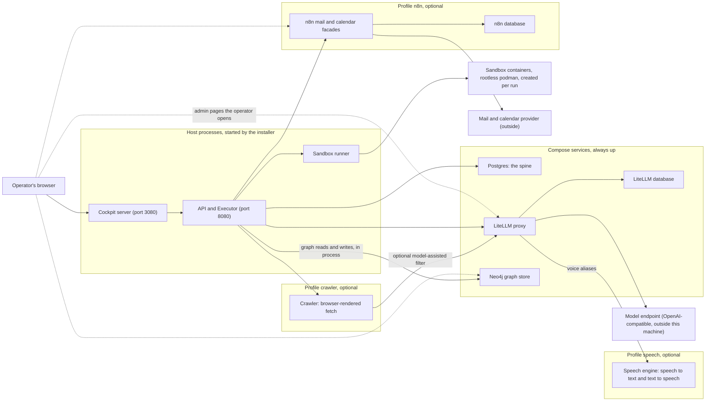
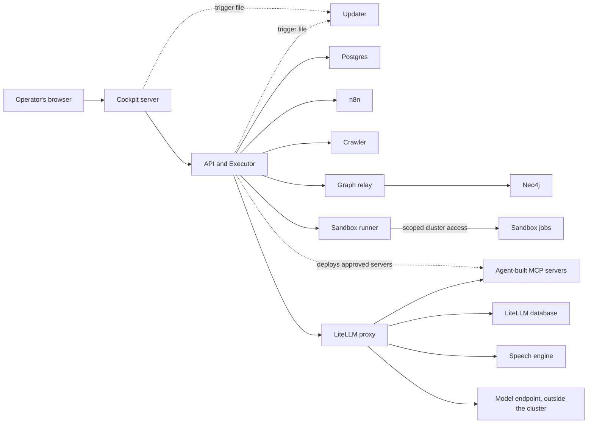
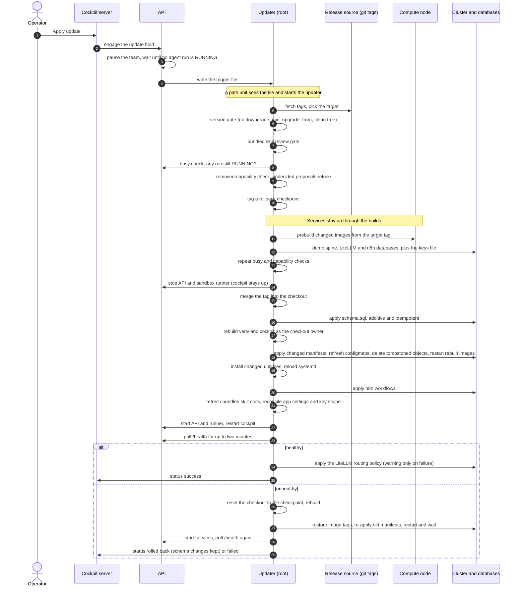

# Deployment

What runs where in the two deploy profiles, and what an update does to the
k3s one. Three diagrams: the single-node profile (Compose), the multi-node
k3s profile, and the k3s updater as a sequence. Roles are named, never
machines: "anchor node" and "compute node" are the labels the k3s runbook
uses, and everything instance-specific belongs to the operator's private
notes.

Reference: [ARCHITECTURE.md](../ARCHITECTURE.md) section 6 (Deploy surfaces),
[deploy/single/README.md](../../deploy/single/README.md) and
[deploy/k3s/README.md](../../deploy/k3s/README.md). Mirrored or no-egress
installs exist for both profiles; start with
[deploy/AIRGAP.md](../../deploy/AIRGAP.md) for those.

## 1. The single-node profile

One machine. Containers run under Compose (`podman compose`); the API, the
cockpit server and the sandbox runner are plain host processes beside them.
Everything published to the host binds the loopback address only.

### Reading it

| Part | What it is | Where in the repo |
|---|---|---|
| Always-up services | Postgres, LiteLLM with its own database (its response cache is in its own memory), and Neo4j. Start order is healthchecks plus `depends_on`, not a script sequence. Postgres loads `schema.sql` only on a fresh database. | `deploy/single/compose.yaml` |
| Profiles | `n8n` (with its database), `crawler` and `speech` are Compose profiles. The installer turns them on from the `CC_ENABLE_*` flags; crawler and speech are on by default, n8n is off. | `compose.yaml` (`profiles:`), `deploy/single/README.md` ("Profiles") |
| Host processes | The API, the cockpit server and the sandbox runner are not containers. `./setup.sh` starts them, through user-level systemd units where the machine has a user manager. | `deploy/single/README.md` ("Starting the sandbox runner"), `deploy/single/supervise-lib.sh` |
| Sandbox | No Compose service. The runner creates a container per run with rootless podman, which the README says is weaker containment than the k3s profile's gVisor. | `deploy/single/README.md` (Containment trade) |
| Graph | No Graphiti server. graphiti-core runs inside the API and speaks bolt to Neo4j. | `deploy/single/README.md` ("What runs") |
| Model endpoint | Not part of the profile. The model catalog lives in LiteLLM's database and is filled in through the LiteLLM admin page during setup. | `deploy/single/README.md` (the `llm` phase) |
| Browser exposure | The operator opens the cockpit server. The tool admin pages (LiteLLM, n8n, Neo4j Browser) are on loopback ports too. Port numbers are the defaults in `compose.yaml`. | `compose.yaml` (`ports:`) |
| Voice | The cockpit's speech features go through LiteLLM aliases that point at the speech engine. | comment above `speech` in `compose.yaml` |

## 2. The multi-node k3s profile

Two nodes, found by label (`cc-role/anchor`, `cc-role/compute`), never by
name. The rule is "split by state": stateful pods are pinned because each
volume is tied to a node, and the one stateless heavyweight (LiteLLM) floats.
The API, the cockpit server, the sandbox runner and the updater are systemd
units on the anchor node, outside the cluster.

| Where | What runs there |
|---|---|
| **Anchor node** (control plane, arm64), as host services outside the cluster | Cockpit server (port 3080), API and Executor (port 8080), sandbox runner (port 8090), the loopback relay to the graph store, the updater (a root one-shot started by a trigger file) |
| **Anchor node**, cluster pods pinned here | Postgres (the spine), the LiteLLM database, n8n and its database |
| **Compute node** (amd64), cluster pods | The LiteLLM proxy (floats, prefers this node), Neo4j (pinned), the crawler and the speech engine (both required here) |
| **Compute node**, separate namespaces | Sandbox jobs under gVisor, one per run; agent-built MCP servers |

Who talks to whom:

### Reading it

| Part | What it is | Where in the repo |
|---|---|---|
| Node roles | The runbook calls them the anchor node (control plane, arm64) and the compute node (agent, amd64). Both are node labels; the manifests never name a machine. | `deploy/k3s/README.md` (sections 1 and 3a), `deploy/k3s/00-namespace.yaml` |
| Pinned versus floating | Postgres, the LiteLLM database and n8n are pinned to the anchor node. Neo4j is pinned to the compute node. LiteLLM prefers the compute node and falls back to the anchor node, with 30-second eviction tolerations. | `deploy/k3s/README.md` (placement table), `20-postgres.yaml`, `30-litellm.yaml`, `40-graph.yaml`, `50-n8n.yaml` |
| Required on compute | The crawler and speech engine have a hard node requirement. Sandbox jobs do too, because gVisor is installed only there. | `70-crawler.yaml`, `90-speech.yaml`, `60-sandbox.yaml` |
| Host services | `cc-uvicorn` (API), `cc-nerve` (cockpit server), `cc-sandbox-runner`, `cc-graph-bolt` (relay) and the `cc-update` path and service units. The API, runner and cockpit units are rendered from `.in` templates. | `deploy/k3s/*.service.in`, `cc-graph-bolt.service`, `cc-update.path`, README section 6 |
| Graph exposure | Neo4j is reachable inside the cluster only. A `socat` relay unit exposes it on loopback for the API. | `cc-graph-bolt.service`, `40-graph.yaml` |
| Exposure rule | Pinned services publish with a loopback-only `hostPort`. Floating services (LiteLLM, crawler, speech) use a LoadBalancer Service, which binds the real port on every node. Every `CC_*` endpoint must resolve to loopback. | `00-namespace.yaml` header, `.claude/rules/deploy-k3s.md` |
| Sandbox and MCP namespaces | `cc-sandbox` holds per-run jobs (default-deny ingress, open egress). `cc-mcp` holds agent-built servers (deny all, one ingress rule from LiteLLM on port 8000). Each is reached through its own scoped kubeconfig. | `60-sandbox.yaml`, `61-mcp.yaml`, `make-sandbox-kubeconfig.sh`, `make-mcp-kubeconfig.sh` |
| Model endpoint | Not a workload of this profile. LiteLLM holds the catalog in its database and the operator fills it in. The public files do not place a model server on either node role. | `deploy/k3s/README.md` (section 1, "Absent" LiteLLM trio) |
| Two built images | Only the sandbox and crawler images are built locally, on the compute node. Everything else is pulled. | README section 3 |

## 3. What an update does (k3s)

The cockpit never applies its own update. It writes a trigger file; a root
one-shot service does the work, and it owns health and rollback. The run is
stateful on disk (`status.json` outside the checkout) so the cockpit can read
the result after its own restart.

### Reading it

| Step | What happens | Where in the script (`deploy/k3s/cc-update.sh`) |
|---|---|---|
| 1 to 4 | The cockpit route refuses an unreviewed skill-doc change, then engages the hold. The API's poller writes the trigger once nothing is running. "Update anyway" skips the wait and writes the trigger from the cockpit route. A path unit then starts the updater, and its `ExecStartPre` moves the trigger to `request.json` so a left-over file cannot loop. | `web/server/routes/cc-update.ts` (262-312), `central_command/api/hold.py`, `cc-update.path`, `cc-update.service.in` |
| 5 to 7 | Resolve and gates: refuse uncommitted tracked files (561), fetch tags (565), pick the target, refuse a downgrade or a source below `min_upgrade_from` (570-583), bundled skill review gate (584). | `main()` from 547 |
| 8 to 10 | Busy check (589), removed-capability check (591), rollback checkpoint tag (593-599). The "Update anyway" request bypasses only the busy check, not the other gates. | 588-599, 388-423 |
| 11 | Prebuild changed images (sandbox, crawler) on the compute node from a detached worktree of the target tag, while services stay up. The running image bytes are retagged first so a rollback can restore them. A failed build changes nothing. | 601-657 |
| 12 | Three database dumps and a keys file (without the keys the LiteLLM and n8n dumps are unreadable). A failed dump refuses the update. | 659-706 |
| 13 | Busy and capability checks again, because the builds and dumps leave a window. | 708-709 |
| 14 | `cc-uvicorn` and `cc-sandbox-runner` stop. This is the first mutation; `cc-nerve` keeps serving progress. | 711-713 |
| 15 to 17 | Merge (715-719). Then the env-file path migration (721, not drawn), the schema (724-726) and the venv and cockpit rebuild (728-729). | 715-729 |
| 18 | Manifests phase: apply changed yaml, refresh the two file-built configmaps, delete the `removed.txt` tombstones, restart deployments whose image bytes moved, wait for rollouts. | 731-793 |
| 19 | Changed unit files are rendered from templates and installed, then systemd reloads. A changed updater unit only takes effect on the next run. | 795-826 |
| 20 to 21 | n8n workflows on every update (836), bundled skill docs (841), app settings and the app key's scope (847). | 828-848 |
| 22 to 23 | Start services (850), then poll `/health` 30 times, 4 seconds apart. | 145-154, 850-854 |
| 24 to 25 | Healthy: apply the LiteLLM policy, then record `success`. | 855-871 |
| 26 to 29 | Unhealthy: stop, `git reset --hard` to the checkpoint, rebuild, restore retagged images, re-apply the old manifests, restart and wait, start services, poll again. | 874-905 |

Only a failed health poll triggers the rollback. Any other failure calls
`die`, which restarts the services if they had been stopped and records
`failed` for that phase: before the merge the tree is untouched, and a merge
conflict is aborted. After the merge a failed phase leaves the merged tree
running with no automatic reset. The schema is additive-only, so a rollback
keeps it.

### The single-node updater, in short

The single-node profile has no root service and no cluster. `update.sh` is a
git-based updater for a tree that arrived as a zip. Its verbs are `init`,
`import`, `stage`, `plan`, `apply` and `rollback`.

| Question | k3s (`cc-update.sh`) | Single-node (`deploy/single/update.sh`) |
|---|---|---|
| Where the new release comes from | A git tag fetched from the release source. | A downloaded release zip, committed by `import` onto a branch named `upstream`. The deployment branch is `local`. |
| What `apply` merges | `git merge` of the tag; local commits can conflict. | A fast-forward only. A tree that cannot fast-forward, or that differs from its commit, is refused. |
| Before anything moves | Image prebuilds. | The new release's own installer runs from a staged copy and acquires every image, build and dependency. A failure there changes nothing. |
| Database dumps | Spine, LiteLLM and n8n databases, plus the two keys. | The spine only (skippable by an explicit setting). |
| After the merge | Schema, rebuild, manifests, units, n8n, skills, settings, start. | Schema, skill docs, then the installer's phases in order (fetch, llm, stack, app, verify), each recorded in a ledger. |
| Who restarts | The updater, then a health poll. | By hand with `./setup.sh`, except when the cockpit drove it (`update-run.sh`: stop, apply, boot, health). |
| Rollback | Automatic when the post-update health poll fails. | `rollback` resets to the last checkpoint tag. The cockpit-driven run rolls back automatically only when `apply` fails after the merge; a failed health check after boot is reported and left for the operator. |

Sources: `deploy/single/update.sh` (header and `cmd_apply`, `cmd_rollback`),
`deploy/single/update-run.sh`, `deploy/single/README.md` ("What `apply` does").

## What this page leaves out

- **The install drivers**: the six k3s phases and the ten single-node phases
  (`setup.sh`, `steps.tsv`, the generated `CHECKLIST.md`).
- **The log console and database console on k3s**: VictoriaLogs, the log
  collector that runs on both nodes, and the loopback database UI.
- **Nightly backup**, including the Neo4j offline dump the updater skips.
- **The stage run**: a separate trigger prebuilds image caches the moment a
  newer release is seen, so the apply goes faster.
- **The restart action**: the same trigger seam can restart the API alone.
- **Reachability from outside the host**: how a private network or a reverse
  proxy exposes the cockpit is the operator's own setup.
- **Air-gapped specifics**: mirrors, CA bundles, proxies. See
  [deploy/AIRGAP.md](../../deploy/AIRGAP.md).
