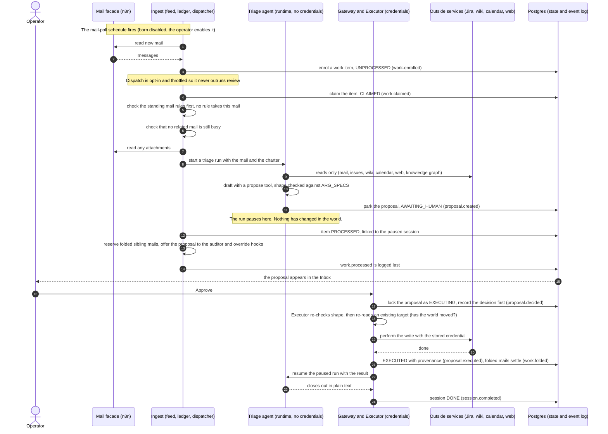

# Life of a mail

How one incoming mail becomes a write in the outside world, and where the
operator decides. This page shows the ordinary path: one mail, one proposal,
approved, executed. The other verdicts, outages and redrafts have their own
pages.

Reference: [ARCHITECTURE.md](../ARCHITECTURE.md) section 3 (Lifecycles) and
section 4 (Spine mechanics, "Ingest"); queue operations in
[QUEUE.md](../QUEUE.md).

## Reading it

| Step | What happens | Where in the code |
|---|---|---|
| 1 to 3 | A heartbeat schedule polls the mail facade and enrols each new mail as a work item. The row is created with its text; the poll logs `work.enrolled`. | `heartbeat/actions.py` (`feed.poll`), `ingest/feed.py` (`poll_once`), `ingest/ledger.py` (`enroll_provider_message`) |
| 4 | The dispatcher claims one item when its valves allow (in-flight count and the approval throttle) and no related item is busy; the claim is one atomic SQL statement, and `work.claimed` is the first thing logged. | `ingest/dispatcher.py` (`check_valves`, `process_claimed`), `db/repo.py` (`claim_next_work_item`) |
| 5 | Standing mail rules are the first check after the claim and before anything that costs: no embedding, no entity extraction, no model call. A matching rule would fold the mail terminally and end the story here. | `ingest/dispatcher.py` (`_match_mail_rule`, `_fold_under_rule`), `ingest/mail_rules.py` |
| 6 to 7 | A second relatedness check now that the text is known (exact keys, entity keys, similarity to anything in flight), then the attachments are read. A related busy item would release this one with a backoff. | `ingest/dispatcher.py` (`_semantic_freeze_check`), `ingest/ledger.py` (`hydrate_attachments`) |
| 8 to 11 | The triage agent gets the mail and its charter, reads through the tools it was granted (mail, Jira, wiki, calendar, web, the graph), and drafts one proposal. It holds no credential, so a draft is all it can produce. A malformed draft goes back to it before the run pauses. | `runtime/run.py` (`ingest_and_propose`), `runtime/tools.py` (`_validate_proposal`), `runtime/proposals.py` (`park_proposal`) |
| 12 | The ledger row goes PROCESSED, which means "the agent took its turn", not "the world changed". It stays busy for related mail until its session is done and its proposal executed. | `ingest/dispatcher.py` (`process_claimed`), `db/repo.py` (`_BUSY_ITEM`) |
| 13 to 14 | Folded siblings are reserved against the proposal, then the auditor and gate-override hooks look at it; on this path neither decides. `work.processed` is the last thing the dispatcher logs, after the proposal and those hooks. | `ingest/dispatcher.py`, `gateway/overrides.py` (`decide_landed`) |
| 15 to 16 | The operator sees the proposal and approves it. | cockpit Inbox, `gateway.approve_and_execute` |
| 17 | The status flip to EXECUTING is the lock against a second click; the decision is then written to the event log before anything it authorises runs. | `db/repo.py` (`claim_proposal_for_execution`), `gateway/gateway.py` (`approve_and_execute`) |
| 18 to 21 | The Executor validates every action's shape, re-reads the target where a world check is registered for it (edits of existing pages, issue transitions and the like; creates and sends are not re-checked), performs the writes in order and stamps the result. Folded siblings become terminal only now. | `gateway/executor.py` (`execute`, `WORLD_CHECKS`), `gateway/gateway.py` (`_record_execution_success`) |
| 22 to 24 | The paused run is resumed with the Executor's result for one more turn. Closing out in text lands the session DONE; if the session belongs to a task, the task resolves DONE as well (a mail triage session has none). | `runtime/durable.py` (`resume`), `gateway/gateway.py` (`finish_decision_resume`, `_resolve_task_after`), `runtime/converse.py` (`land_session`) |

## What this page leaves out

- **Reject and Dismiss**: the other two verdicts.
- **A gate override or the auditor deciding** instead of the operator.
- **An outage**: an approved write that parks and is retried; a mail that is released with a backoff while a dependency is down.
- **A failed or world-moved execution**, which sends the drafter back to redraft.
- **Folds**: sibling mails folded into one proposal.
- **Other endings of a triage run**: a question to the operator, a consult with a specialist, a "no action needed" claim that waits for the operator to confirm, a follow-on proposal after the approved one.
- **A mail rule taking the mail** before the agent ever sees it.
