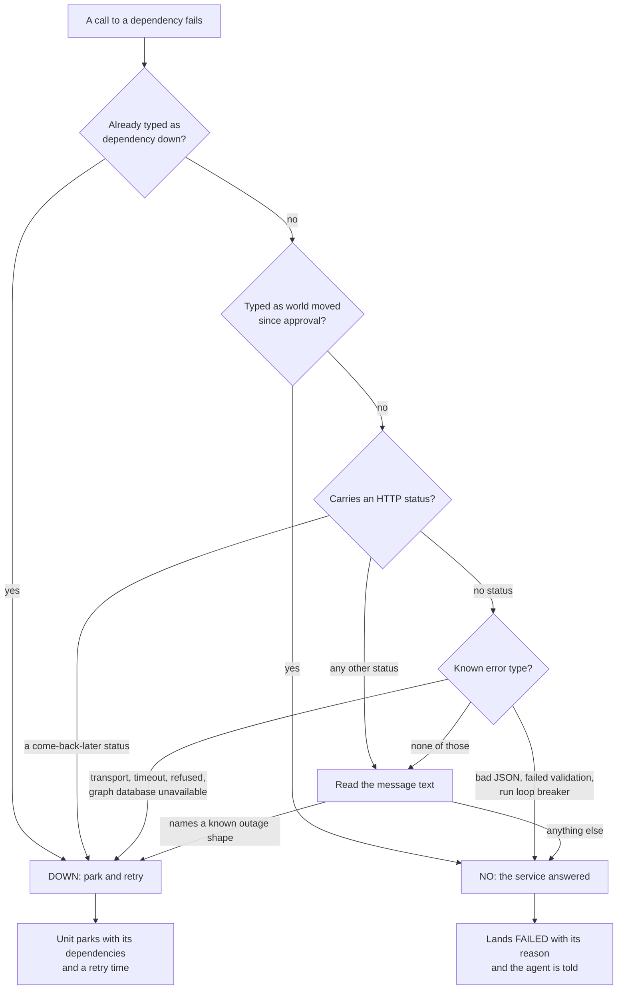
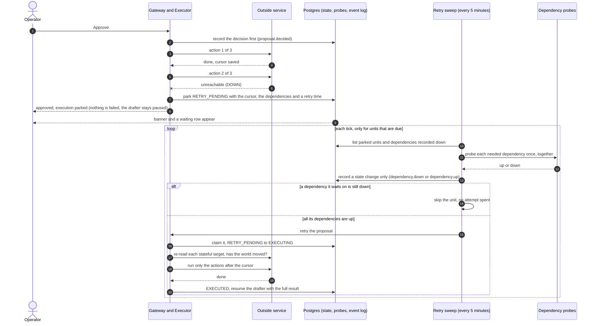

# Outage handling

What happens to work in flight when a dependency is down: the model server, an
outside service such as Jira, the embedder, the graph database. The doctrine is
one sentence: **a dependency that is down costs latency, never work.** Nothing
becomes FAILED because a service was unreachable, the operator sees a banner
rather than a failure, and once the service is back the work ends with the same
result as if it had never been offline.

Two things make that hold. First, every failure is sorted into DOWN ("come back
later") or NO ("the service answered and refused") in one place. Only a NO may
end work. Second, every unit of work that meets a DOWN parks itself with a
record of what it waits on, and a recurring sweep re-drives it once that
dependency is healthy again.

Reference: [ARCHITECTURE.md](../ARCHITECTURE.md), "The outage doctrine" and the
Proposal state diagram; the bite marks in
`.claude/rules/runtime-resilience.md`. For the ordinary path that this page
branches off, see [Life of a mail](life-of-a-mail.md).

## Down or no

One classifier decides, and an error it does not recognise is a NO, because a
real error hidden behind a quiet retry loop is worse than a loud failure.

The come-back-later statuses are 403, 408, 429, 500, 502, 503, 504 and 529. A
403 counts as DOWN because an edge firewall denies with it; a 401 does not,
because no credential appears by waiting. A group of failures (one per
fallback model, say) is DOWN only when every member is. A world-moved NO is
never parked and never retried as-is: replaying an approved write against a
target that changed would overwrite what nobody reviewed, so it lands FAILED
and the drafter reads the target again and redrafts.

## An approved write meets an outage

The case that matters most: the operator has already approved, and the
Executor cannot reach the service. The decision stands; only the write waits.

Three other endings are possible at the retry. Down again: the proposal parks
again, one attempt older and one step further along the backoff, with no limit.
World moved: it lands FAILED and the drafter redrafts, as on any NO. Another
NO: it lands FAILED with the actions that did land listed.

## Reading it

| Step | What happens | Where in the code |
|---|---|---|
| Classification | One function sorts a raised error into DOWN or NO, most specific evidence first and message text last. Unknown is NO. | `contract/failures.py` (`classify_failure`, `TRANSIENT_STATUS`, `WorldMoved`, `DependencyDown`) |
| 1 to 2 | The approval is logged before anything it authorises runs. | `gateway/gateway.py` (`approve_and_execute`) |
| 3 to 4 | The Executor writes a cursor around every action (in flight before, result after), so a retry knows exactly which actions landed. | `gateway/executor.py` (`execute`, `record_progress`), `db/repo.py` (`record_action_started`, `record_action_completed`) |
| 5 to 6 | The failing handler's error is judged where it is raised and the verdict rides on the failure, with the dependencies it needed. | `gateway/executor.py` (`_execution_failed`, `ExecutionFailed`) |
| 7 to 8 | The gateway reads that verdict; a DOWN parks the proposal instead of failing it. Folds are not released and the drafter is not resumed, because the write is still expected to happen. | `gateway/gateway.py` (`_execution_transient`, `_park_execution_retry`), `db/repo.py` (`park_proposal_retry`) |
| 9 | The waiting row and the banner. | `api/outages.py` (`list_outages`), `api/routes.py` (`waiting_facts`), `web/src/features/outages/`, `web/src/features/decisions/DecisionsView.tsx` |
| 10 to 11 | The sweep is a seeded heartbeat schedule. It lists due units on three worklists (sessions, approved proposals, tasks), then probes every dependency they need plus every dependency recorded down, concurrently and once each. | `heartbeat/actions.py` (`_retry_sweep`), `api/orchestration.py` (`retry_sweep`), `db/schema.sql` (the `retry-sweep` seed) |
| 11 to 13 | The probe cache answers one probe per name per sweep; a probe that raises or times out counts as down. A state change, and only a change, is written to `dependency_probe` and logged. | `heartbeat/probes.py` (`ProbeCache`, `probe_llm`), `api/orchestration.py` (`probe_and_record`, `_record_probe_changes`), `db/repo.py` (`record_dependency_probe`) |
| 14 | A unit whose recorded dependency is down is skipped before its driver is called, so an outage can never advance its attempts or its retry time. | `api/orchestration.py` (`retry_sweep`, the `if down` branch of `_drive`) |
| 15 to 16 | The retry claims the row in SQL, so two sweeps cannot both replay it, and runs under the approver the operator's decision recorded: a retry re-executes work, never a gate. | `gateway/gateway.py` (`retry_execution`), `db/repo.py` (`claim_proposal_retry`) |
| 17 | Before the first remaining action the Executor re-reads each stateful target (a Confluence page version, a Jira transition, a graph deletion preview, a charter or skill document version). A mismatch is a world-moved NO. | `gateway/executor.py` (`WORLD_CHECKS`, `_recheck_world`, called from `execute`) |
| 18 to 20 | Only the actions after the cursor run; completed ones never re-run. On success the full result of all attempts goes back to the drafter. | `gateway/gateway.py` (`retry_execution`, `_record_execution_success`) |

## What parks where

Each kind of in-flight thing parks in its own shape, and each records which
dependencies it waits on so the sweep and the banner can tell which outage a
unit belongs to. A record with no dependencies reads as the model server.

| In flight | What it does on a DOWN | Who drives it afterwards | Where in the code |
|---|---|---|---|
| An approved proposal mid-execution | Status `RETRY_PENDING`, with the cursor, the dependencies, the attempt count and a retry time. | The retry sweep, or the operator's retry-now. | `gateway/gateway.py` (`_park_execution_retry`) |
| A ledger work item (a mail being triaged) | Released back to `UNPROCESSED` with a `not_before` time and a `dependencies` list. The attempt the claim used is handed back. No attempt limit applies to this path. | The normal dispatch loop, because the claim query will not pick a row before its `not_before`. The sweep deliberately does not touch work items. | `ingest/dispatcher.py` (`process_claimed`), `db/repo.py` (`release_work_item`) |
| A task run | Task goes back to `ASSIGNED` with a retry record and a hint that it is queued for retry. | The retry sweep, through the same entry the first run used. | `api/routes.py` (`_land_run_failure`), `api/orchestration.py` (`park_task_retry`, `retry_parked_task`) |
| A session (a live read, a model turn, or the resume after a decision) | Status `AWAITING_RESUME` with a `pending_resume` record naming the dependencies, the attempt count and a retry time. | The retry sweep, which also requires the model server to be up because a resume is a model turn. | `runtime/resume_park.py` (`park_resume`), `api/orchestration.py` (`resume_parked_session`) |
| A graph ingest job | Deferred to `QUEUED` with a `not_before` time and a `dependencies` list. | The ingest worker's own loop. | `db/repo.py` (`defer_ingest_job`) |

Every parked surface waits the same amount: 60 seconds times two to the
number of earlier failures, capped (an hour by default, set by
`CC_RETRY_BACKOFF_CAP_SECONDS`). A flap costs a minute; a long outage settles
into one re-check per cap. There is no attempt limit, and DOWN never promotes
anything to FAILED (`contract/failures.py`, `retry_backoff_seconds`).

## The sweep

- **A seeded heartbeat schedule**, every 300 seconds, seeded enabled. The
  operator can disable it like any other schedule.
- **A no-op when nothing is parked.** With nothing waiting and nothing recorded
  down it makes no probe and writes nothing. The ordinary tick finds nothing.
- **It only re-drives what was already authorised.** An approved proposal's
  decision, an operator's task, a session already mid-resume. It opens no gate
  and creates no work.
- **It never waits on agent work.** Session resumes and task re-runs are
  dispatched in the background and the tick returns at once; the proposal
  retry is awaited because it is the Executor's own call.
- **It never moves an interrupted proposal.** A proposal parked because the
  process restarted mid-execution may have had one action land already, so only
  the operator's explicit retry or a dismiss moves it.
- **It stays quiet about probe-gated skips.** A tick that only skipped units
  leaves no heartbeat history (the dependency change itself is still logged). A unit that fails repeatedly while every dependency it
  recorded probes healthy (a revoked key answering 403, for instance) is
  reported once per failure episode as `retry.failing_despite_probe`, after
  three failures by default, and keeps retrying.

## The operator's view and exits

- **The banner.** One per down dependency: how long it has been down, how many
  items wait on it by kind, and a Retry now button. One more per dependency
  with work failing against a healthy one. Backed by `GET /api/outages`.
- **The waiting list.** Approved proposals on `RETRY_PENDING` appear in their own
  section of the Inbox, apart from proposals needing a decision (the decision is
  made). Each row reads one of three ways: approved and waiting on the
  dependency with its down-since time and next retry; interrupted by a restart,
  retry or dismiss; or failing despite a healthy dependency, with the last error.
- **Retry now.** Writes `outage.retry_requested` first, probes that one
  dependency through the same step the sweep uses, and only if it is up drives
  the units waiting on it with their backoff ignored (`api/outages.py`,
  `retry_outage`). Ledger items and ingest jobs are brought due for their own
  loops. Interrupted proposals are driven only when the operator ticks the
  explicit flag, after a confirmation that a prefix of their actions may have
  landed.
- **Dismiss an approved-but-parked proposal.** One SQL-guarded transition to
  `WITHDRAWN`, so a dismiss racing a retry's claim cannot both withdraw and
  execute. It withdraws the execution, not the decision: no second
  `proposal.decided`, a distinct `proposal.execution_dismissed` event, folds
  released, the drafter's session closed and never resumed. The task resolves
  **FAILED**, never DONE, saying how many actions had landed. Dismissing a
  proposal that was still awaiting a decision keeps its DONE "no action
  needed" (`gateway/gateway.py`, `dismiss_proposal` and
  `_dismiss_waiting_execution`).

## What this page leaves out

- **The startup landing**: what a process restart does to running sessions,
  tasks, ledger claims and `EXECUTING` proposals.
- **Parked reads and parked model turns** in detail: how a run pauses mid-run
  through the one deferred-call mechanism and re-enters through its landing
  tail.
- **The embedder's recorded identity**: a model swapped behind the alias holds
  the embedder DOWN until the operator re-embeds.
- **Idempotency of retried creates**: which capabilities carry a key so a
  re-run lands once, and which may still apply twice.
- **Redrafts after a world-moved NO**, and the limit on how many a chain gets.
- **The full dependency vocabulary** and which tool or capability maps to which
  dependency.
