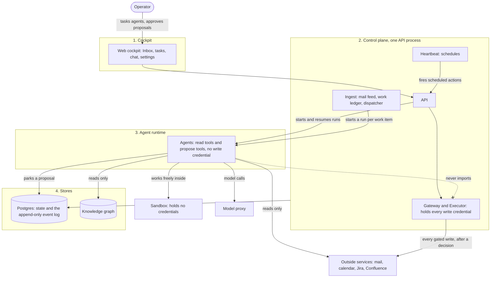

# System overview

The four tiers of Central Command and the one rule that shapes them: **agents
draft, the operator decides, and only the Executor holds a credential that can
change anything.**

This is the simplified map for a first read. The full version, with every
package, is the flowchart at the top of
[ARCHITECTURE.md](../ARCHITECTURE.md) section 1.

## Reading it

| Part | What it is | Where in the code |
|---|---|---|
| Cockpit | The operator's screen. It holds the API's address and no outside credential. | `web/` |
| API | The one FastAPI process that hosts the control plane. | `central_command/api/` |
| Ingest | Turns incoming mail and files into work items and hands them to agents under backpressure. | `central_command/ingest/` |
| Heartbeat | The scheduler behind every recurring action. | `central_command/heartbeat/` |
| Gateway and Executor | Decides proposals and performs approved writes. The only tier that holds write credentials. | `central_command/gateway/` |
| Agent runtime | Runs the agents. Holds read credentials only; every tool that changes an outside service is a proposal. | `central_command/runtime/` |
| Postgres | The spine: sessions, proposals, tasks, the work ledger and the event log. | `central_command/db/` |
| Knowledge graph | What the team knows about people, projects and facts. | `central_command/integrations/` (graphiti-core, Neo4j) |
| Sandbox | A place for agents to run code. It is containment: open network, no credentials. | `central_command/sandbox/` |

## The dotted line

The runtime may never import the gateway or the Executor. That is the trust
boundary, and a test walks the import graph to enforce it. An agent cannot
perform a write even if one is approved by mistake, because the code that
writes is not reachable from the tier the agent runs in.

## What this page leaves out

- **The shared vocabulary package** (`contract/`) that both tiers import.
- **The exceptions**: the two ungated deterministic writes, and MCP tools the
  operator has marked ungated. See [Who approves](who-approves.md).
- **The individual integrations** and the n8n facades in front of mail and
  calendar.
- **Where each piece runs.** See [Deployment](deployment.md).
