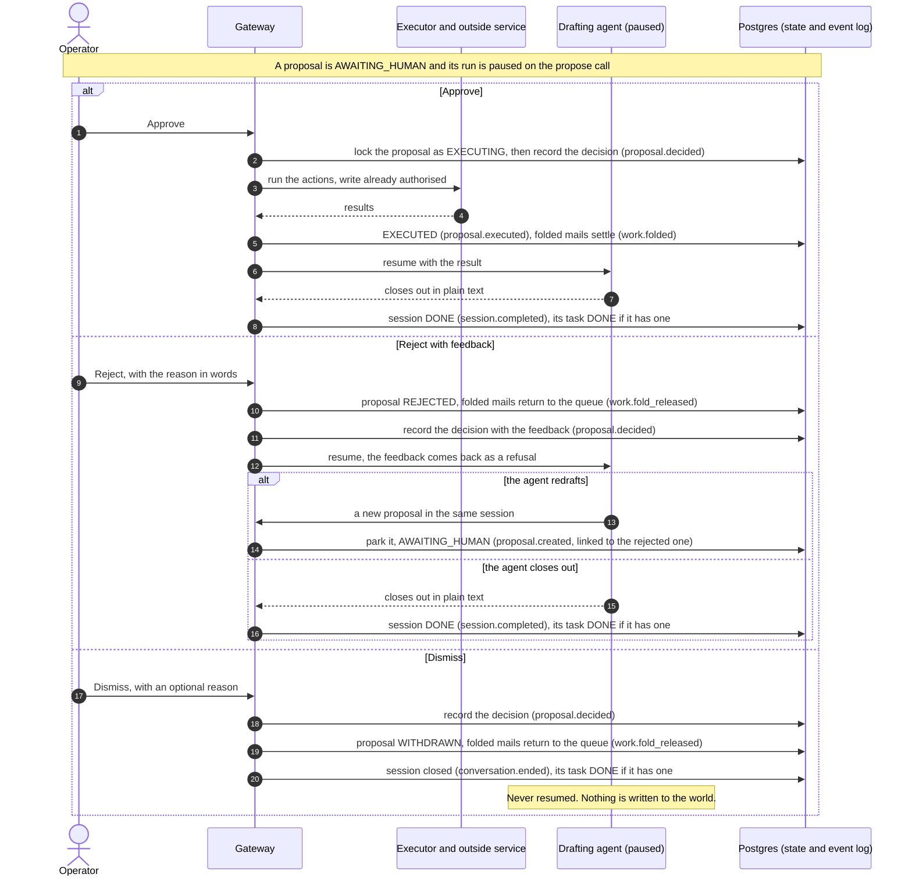

# The three verdicts

What happens when the operator decides a proposal that is waiting in the
Inbox. There are exactly three verdicts, and they are not variations of one
another: **Approve** performs the write, **Reject** sends the drafter back to
try again, and **Dismiss** closes the matter without ever asking the agent
anything. Rejecting to make a proposal go away is the trap Dismiss exists to
end, because a rejected drafter is resumed and will often redraft.

Reference: [ARCHITECTURE.md](../ARCHITECTURE.md) section 3 (Lifecycles,
"Proposal"); the rule itself is "A proposal has THREE verdicts" in
[AGENTS.md](../../AGENTS.md). For the ordinary path that leads up to the
decision, see [Life of a mail](life-of-a-mail.md).

## At a glance

| | Approve | Reject | Dismiss |
|---|---|---|---|
| Changes the world | yes, the Executor runs the actions | no | no |
| Proposal ends as | EXECUTED | REJECTED | WITHDRAWN |
| Agent resumed | yes, with the real result | yes, with the operator's words as a refusal | never |
| Session | closes DONE when the agent closes out (it stays open if the agent drafts a follow-on proposal) | stays open for a redraft, or closes DONE if the agent closes out | closed at once, the transcript is kept |
| Task, if the session belongs to one | DONE with the Executor's result as the outcome | DONE with the agent's closing text, unless a redraft keeps it open | DONE, "no action needed" |
| Folded sibling mails | become terminal (FOLDED) | released back to the queue (UNPROCESSED) | released back to the queue |
| Decision event | `proposal.decided`, verdict approved | `proposal.decided`, verdict rejected, with the feedback | `proposal.decided`, verdict dismissed, with the reason |
| Events that follow | `proposal.executed`, `work.folded`, `session.completed`, `task.completed` | `work.fold_released`, then either `proposal.created` (the redraft) or `session.completed` and `task.completed` | `work.fold_released`, `conversation.ended`, `task.completed` |

Events are written only where there is something to record: the fold events need folded mails, and the task events need a task (a mail triage session has none).

## Reading it

| Step | What happens | Where in the code |
|---|---|---|
| 1 to 2 | Approve claims the proposal by flipping its status to EXECUTING, which is the lock against a double click, and records `proposal.decided` before the Executor runs, so the log never shows execution before approval. | `gateway/gateway.py` (`approve_and_execute`), `db/repo.py` (`claim_proposal_for_execution`) |
| 3 to 5 | The Executor re-validates every action, re-reads targets where a world check exists, performs the writes and stamps provenance. Success lands the proposal EXECUTED and commits the folds. | `gateway/executor.py` (`execute`), `gateway/gateway.py` (`_record_execution_success`) |
| 6 to 8 | The paused run is resumed with the result. Closing out lands the session DONE and resolves the task. A proposal raised inside a chat lane returns the lane to the operator instead of closing it. | `gateway/gateway.py` (`finish_decision_resume`, `_resolve_task_after`), `runtime/converse.py` (`land_session`) |
| 9 to 12 | Reject is allowed on a proposal that is awaiting a decision. It flips the status and releases the folds before it writes `proposal.decided`, then resumes the drafter with the operator's words framed as a refusal. The resume is armed first, so a restart finishes it. | `gateway/gateway.py` (`reject_with_feedback`, `release_folds_for`), `runtime/resume_park.py` |
| 13 to 14 | A redraft is parked like any proposal, linked to the one it replaces, and its quotes of the operator are re-checked against the recorded feedback. A redraft is never decided by a standing override. | `gateway/gateway.py` (`finish_decision_resume`, `_park_redraft`), `gateway/overrides.py` (`record_unevaluated_park`) |
| 15 to 16 | If the agent closes out instead, the session lands DONE and the task resolves DONE with the closing text: the operator declined the change and the review cycle is complete. | `gateway/gateway.py` (`finish_decision_resume`) |
| 17 to 20 | Dismiss records the decision first, then withdraws the proposal, releases the folds and closes the session through the one close path. The agent is never resumed and the session is excluded from the end-of-session reflection, so nothing can re-propose it. | `gateway/gateway.py` (`dismiss_proposal`), `runtime/converse.py` (`close_session`) |

## What this page leaves out

- **A failed or world-moved execution after Approve**: the drafter is resumed to redraft, or the task fails once the redraft limit is reached. The ordinary Approve path above assumes the write succeeds.
- **An outage during Approve**: the approved proposal waits as RETRY_PENDING and is retried; the operator may Dismiss it there, which withdraws the execution (not the decision), writes `proposal.execution_dismissed` and resolves the task FAILED rather than DONE.
- **Who decided**: the same Approve path is used by the auditor and by a standing gate override; see [Who approves](who-approves.md).
- **An agent waiting on a consult**: closing a dismissed session wakes an asking agent with the news that the operator dismissed it.
