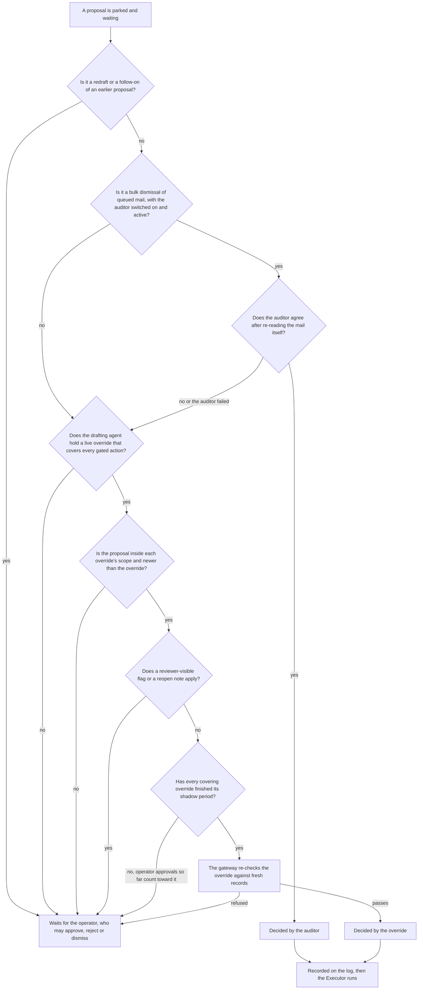
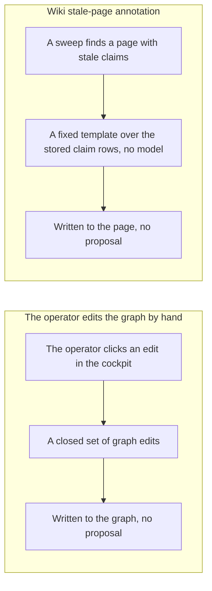

# Who approves

Every change to the outside world goes through one seam, the gateway's approve
step, and that seam runs the same Executor whoever decides. What varies is the
decider. A proposal can be decided by the **operator**, by the **auditor**
(an independent second agent, for one narrow class) or by a **standing gate
override** (a rule the operator wrote in advance for one agent and one
capability). This page shows how a freshly parked proposal finds its decider.
The default is always the operator.

Reference: [ARCHITECTURE.md](../ARCHITECTURE.md) "Who may approve what" and the
Proposal lifecycle; the policy is in [AGENTS.md](../../AGENTS.md) under
"Policy". For what each verdict does once the operator decides, see
[The three verdicts](three-verdicts.md).

## The default gate

Each capability carries a default gate on its registry row. Nearly every write
is **human approval**. One class, bulk dismissal of queued mail, is marked
**auditor**, meaning a graduated auditor may confirm it when the operator has
switched that on. Reads and the sandbox's own writes are **ungated**: no
proposal is needed. An override can only relax human or auditor to none, never
tighten anything and never move a gate to the auditor.

## Deciding a parked proposal

A reading of the boxes that the labels leave short:

- **Scope** includes the capability being the one the override names, the
  override's narrowing by argument, target or schedule, the capability still
  being inside the agent's live pack grants (an override whose grant is gone is
  suspended), and a recorded acknowledgement where the capability's class needs
  one.
- **A flag** is anything the Inbox review would have shown: a deterministic
  policy flag, a capability outside the agent's grants, a malformed draft or an
  evidence quote that does not match its recorded source.
- **The operator can always decide a proposal that is still waiting.** An
  operator's own approval is never checked against an override.

## Things that always wait for the operator

| What | Why it never goes to the auditor or an override |
|---|---|
| A redraft, after a Reject, a failed execution or a moved world | A redraft against a moved world must not be waved through by the standing rule that covered the first draft. Recorded unevaluated at the moment it is parked. |
| A follow-on proposal parked after an approved one | Same reason: it is not evaluated, and goes to the operator. |
| Anything a reviewer would have seen flagged | An override changes who decides, never what the decider is shown. |
| A proposal whose mail the operator reopened with a note | The note means "eyes on this"; neither the auditor nor an override decides it. |
| An irreversible capability, for the auditor | The mark is read from the registry, never from the agent's own claim. The auditor's attempt is refused with no decision and no write, and a graduation-barred event is logged. |
| A gated action no override covers | One uncovered gated action parks the whole proposal. |
| An override still in its shadow period | A new override first watches the operator decide N matching proposals (default 5). |
| An override on an irreversible or highest-blast-radius capability | It needs an acknowledgement when it is authored, and its shadow period is at least 1 even if the setting is 0. |

## What a standing override is

- **Authored only by the operator**, in the cockpit, for one agent and one
  capability, optionally narrowed by argument, target or schedule. Revoking is
  a timestamp, never a delete. No agent tool, charter or chat lane can create
  one, and agents are not told overrides exist.
- **The auditor never holds one.** A row naming the auditor is never honoured.
- **A write an override decides is still a proposal**, decided by the gateway
  with the approver recorded as `override:<id>` (several ids joined, sorted,
  when several overrides cover different actions), logged before the Executor
  runs, and re-checked by the Executor before its first action. The stored
  record carries the override's name; it is never recorded as the operator and
  never as the system.
- **The shadow period counts only the operator's own approvals** of matching
  proposals created after the override was granted. An approval by an
  override, by the auditor or by the system does not count, nor does a
  redraft or a follow-on.
- **An override's decision is never operator agreement.** It is skipped when
  the system measures whether the auditor agrees with the operator, and it is
  not a coaching signal.

## Two writes with no proposal at all

These are the only two, named in one closed list beside the capability
registry, because no agent judgment is in the path that a reviewer could
check. The wiki annotation only runs when the operator has set that mode to
automatic, and it is off by default. Adding to the list is the operator's call,
never an agent's. Creating a task is a different thing again: a trigger with no
gate, not an exemption.

## Reading it

| Part | What happens | Where in the code |
|---|---|---|
| Default gate | Every registry row declares who decides when no override applies; the registry refuses an auditor gate on an irreversible row when it loads. | `gateway/capabilities.py` (`Capability.default_gate`, `EXEMPT_WRITES`) |
| Redraft and follow-on first | Both are recorded as unevaluated at the park itself, so the hooks below find an evaluation already on the row and do nothing. | `gateway/gateway.py` (`_park_redraft`, `finish_decision_resume`), `gateway/overrides.py` (`record_unevaluated_park`) |
| Auditor, then override | After a mail run parks a proposal, the dispatcher offers a bulk dismissal to the auditor (it approves only in active mode, on agreement, with no reopen note, and only when the proposal reserved queued mail, so a bulk dismissal raised in chat is never auditor-decided), then offers every proposal to the override hook. A challenge or an auditor error leaves it waiting, and a covering override may still decide it. | `ingest/dispatcher.py` (`process_claimed`), `gateway/auditor.py` (`audit_bulk_dismissal`) |
| The override decision | One function walks each gated action: override live and the drafter's, capability in the agent's grants, acknowledgement where required, gate none, scope, proposal newer than the override, shadow period complete. Then flags, the reopen note, and whether any gated action is left uncovered. | `gateway/overrides.py` (`resolve`, `review_flags`, `operator_hold_reason`, `shadow_state`) |
| Decide and run | The hook records its evaluation once, then calls the same approve step with the override as approver. The gateway re-checks everything read-only against fresh rows before it writes the decision, and the Executor repeats the check before its first action. A refusal hands the proposal back to the operator. | `gateway/overrides.py` (`decide_on_park`, `check_override_approval`), `gateway/gateway.py` (`approve_and_execute`), `gateway/executor.py` (`execute`) |
| Irreversible and the auditor | The approve step refuses an auditor over an irreversible capability after it takes the claim and before it writes a decision, hands the claim back and logs the bar. | `gateway/gateway.py` (`_refuse_auditor_on_irreversible`), `gateway/capabilities.py` (`is_barred_from_graduation`) |
| Startup sweep | A restart can kill a hook mid-flight, so a startup pass evaluates proposals no override has looked at yet, only for overrides older than the proposal. | `gateway/overrides.py` (`override_sweep`) |
| Ungated writes | The operator's graph edits are routes that call the graph writer directly; the wiki annotation is a function in the freshness sweep, gated by one setting. | `api/routes.py`, `integrations/neo4j_writer.py`, `ingest/wiki_freshness.py` |

## What this page leaves out

- **The auditor's other jobs.** It also confirms or challenges a single "no action needed" claim on a mail or document (there is no proposal in that path), and it closes graph verification rows after an approved episode has already been written. Neither approves a proposal.
- **Whether a class has graduated.** Graduation is configuration and rests on recorded agreement between auditor and operator; a fresh install is fully human-gated.
- **An agent's direct tool call to an outside tool server.** That has its own, older gate, set per tool and per agent in the cockpit, and it is separate from proposals.
- **Authoring, revoking and the cockpit screens** for overrides.
